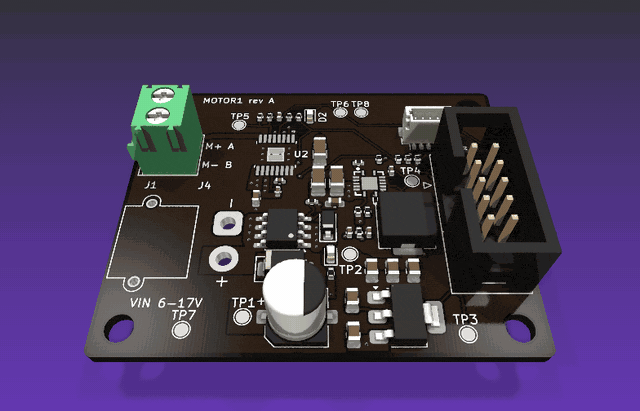
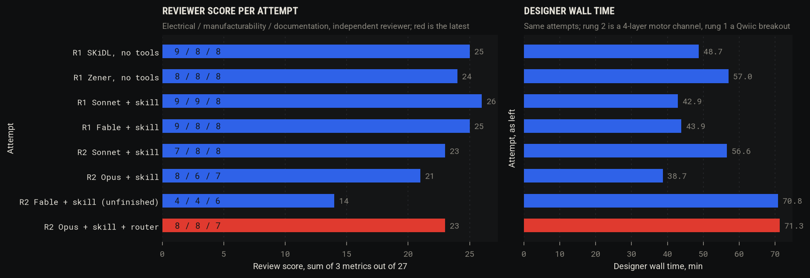
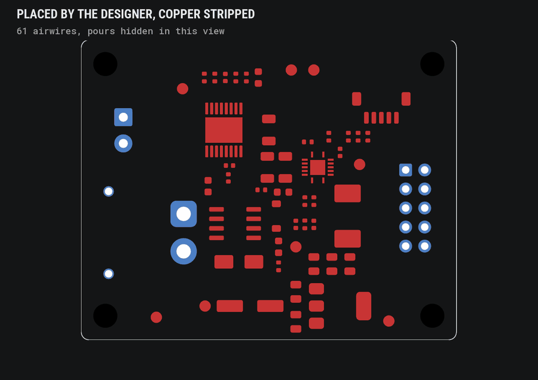
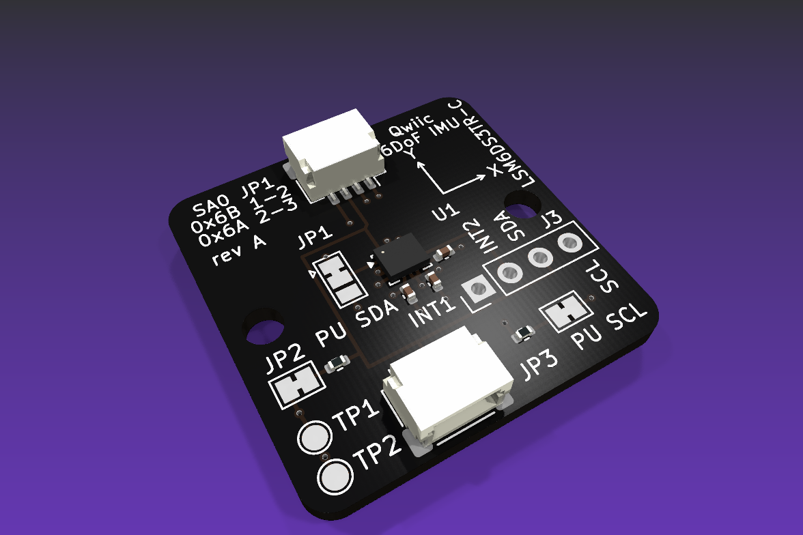
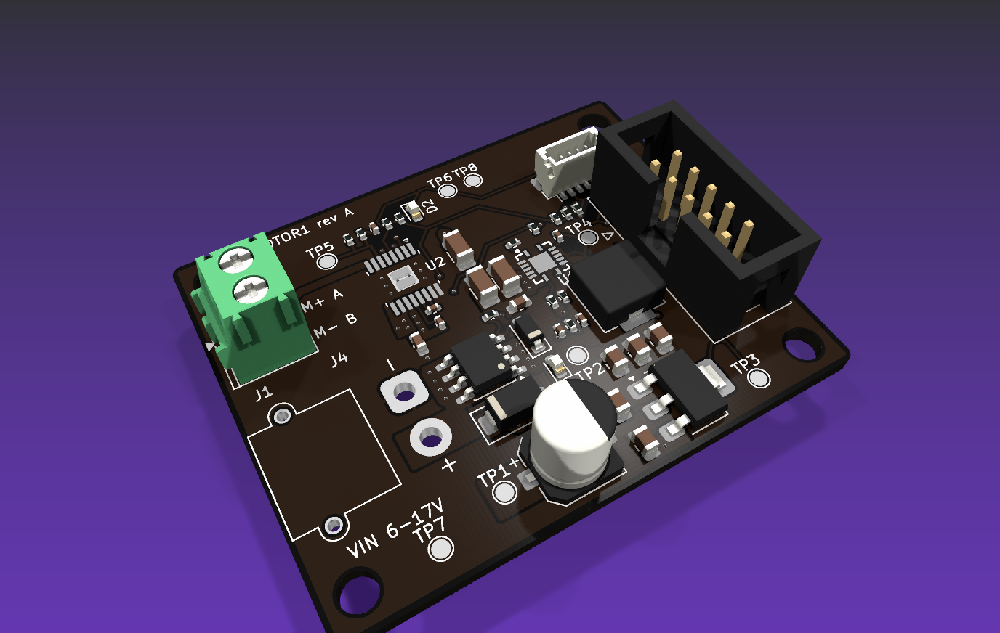

# alex-pcb-skills

**Pilot release: [v0.1.0-rc.1](docs/releases/v0.1.0-rc.1.md).** The completed tool changes are consolidated for
reviewed pilot-board trials. No board from this design loop has been manufactured and validated yet.

**Claude designs KiCad boards from code, routes them with a deterministic router, checks them the way an electrical
reviewer would, and packages them for the fab. Every rule in the skills points at a measured finding.**

<p align="center"></p>

<p align="center"><sub>A brushed-DC motor channel (DRV8874 H-bridge, TPS54620 buck, AMS1117 LDO, encoder port, 2x5 control
header, 4 layers, 50 x 40 mm), designed from a one-page brief by Claude Opus 5.5 in 71 minutes, routed by
<code>pcb route auto</code>, scored 8 / 8 / 7 by an independent reviewer agent. Nothing in it was drawn by hand.</sub></p>

## Why

An engineer's week on a board goes mostly to things a machine does better: checking every pin against the datasheet,
every rail against its current, every cap against its distance, every claim in the design log against the file. Agents
write schematics as code well (the netlist has been right on every attempt so far) and they fail in the same places every
time: a 3 A rail reaching a header pin through four 0.3 mm thermal spokes, a bulk cap fed through a chain of single vias,
a 2x10 part bought for a 2x5 footprint, a board setting lowered until DRC reads zero. ERC and DRC are blind to all of
these. `pcbcheck` turns the brief into rows that fail on them, `pcb q` measures the board so the designer and the reviewer
argue over numbers, and the reviewer's new majors become rows within a day.

Same briefs, scored by an independent reviewer agent on electrical correctness, manufacturability and documentation:

| | Rung 1, Qwiic IMU breakout | Rung 2, motor channel |
|---|---|---|
| Without the tools | 9 / 8 / 8 in 48.7 min (best of two) | not attempted |
| With the designer skill | **9 / 9 / 8 in 42.9 min** | 8 / 6 / 7 in 38.7 min (best of three) |
| With the skill and `pcb route auto` | | **8 / 8 / 7 in 71.3 min** |



The time went where the evidence said it would: three designers lost most of a rung-2 run at the DRV8874's 0.65 mm pitch,
so the next tool was a router. It routes the finished boards clean in under a minute with half the designers' vias. The
score moved; the time did not yet, because the router was allowed to make choices that are rules. That is the next item
in [`docs/ROADMAP-2026-11-01.md`](docs/ROADMAP-2026-11-01.md).

## What a run looks like

1. **Code is the source of truth.** The designer writes Zener (or SKiDL) modules, one per subsystem. The KiCad schematic
   and board are generated, and `pcb regen-check` proves the hand-placed copper survives a regeneration from a clean tree.
2. **Placement and pours by script**, with `pcblib.board` over pcbnew. Net classes, planes and keepouts come from
   `checks.json`, the declared intent: rails, currents, buses, pin maps, test points.
3. **Routing by tool.** `pcb route auto` wraps KiCadRoutingTools: engine pass, refill, dual DRC, a second pass on what is
   still open, a stitch pass. Clean means zero airwires and no new errors; the router's own "all routed" is never the
   verdict.
4. **Checks that read the brief.** `pcb check` runs the intent rows; `pcb drc` runs KiCad's DRC twice, plain and with the
   fab's rule pack, and refuses a board setup lowered below the policy.
5. **Fab package and bring-up.** Gerbers, drill, JLC BOM and CPL with sourcing fields on every part, renders, a numbered
   `BRINGUP.md` with expected readings.
6. **Independent review.** A second agent re-runs everything on a copy, re-measures every claim with `pcb q`, and scores
   against anchors. Its findings are labelled on the archived board and replayed against every tool commit.

<p align="center"></p>

<p align="center"><sub>The attempt-2 board with the designer's copper stripped and placement kept, then <code>pcb route auto</code>:
61 airwires to 0 in 39.5 s, 43 vias against the designer's 64. The verdict is NOT CLEAN because one thermal relief is
starved, and that one error is what the designer gets back. Pours are hidden in this view.</sub></p>

## What it catches

| Rows | Catch |
|---|---|
| `feeds`, `currents` | A pin on a wide net fed through a via, a pour neck or plane spokes below the declared current (IPC-2221, barrel plating included); a 0.2 mm track on a 3 A net |
| `decoupling`, `thermal_vias` | A bypass cap farther from its pin than the datasheet asks, on any pin type; too few vias under a thermal pad |
| `policy`, `fields` | Clearance, track, via and silk minimums lowered below the brief; parts without MPN, Manufacturer, LCSC and Datasheet |
| `calcs` | Pull-up current, buck ripple, LDO dissipation, sense scaling, each a formula with a limit that reads values from the netlist |
| pin maps, connectors, jumpers, test points | The control header against the firmware table, Qwiic pin order, address jumpers, every test point in the bring-up doc |
| dual DRC, `regen-check` | Errors that only show with the fab pack loaded; copper that does not survive regeneration |

Every row cites the finding that motivated it in [`docs/FINDINGS.md`](docs/FINDINGS.md). The replay bench
(`tools/bench/`) holds 10 boards and 41 labelled findings, including MotorGo Plink's real fab bugs; a tool commit has to
raise recall without adding a false fail. `tools/verify_all.sh` runs the integration and regression checks; see the release notes for the current validation result and prerequisites.

<p align="center"> </p>

<p align="center"><sub>Rung 1, a Qwiic LSM6DS3TR-C breakout (Sonnet 5.5 with the skill, 9 / 9 / 8), and rung 2, the motor channel
(Opus 5.5 with the skill and the router, 8 / 8 / 7). Both are in <code>examples/</code> with their configs, reviews and labels.</sub></p>

## Where it is

- The sensor breakout received reviewer scores of 9 on electrical with minors only; it has not been physically validated. The
  named risk for a new part is sourcing: the one blocker in rung 2 was an LCSC part that did not match its footprint,
  and the row for that is next.
- The motor channel works on paper and would be a rev A with errata: the reviewer's three majors are a header pin on
  plane spokes, a bulk cap on a via chain, and no copper under the LDO. All three are labelled and all three are the
  router's choices, which the staged router removes.
- Nothing from the loop has been built yet. Every score is reviewer-measured. Ordering the two best boards is the
  cheapest calibration available and is spike [#3](https://github.com/alexchunlin/alex-pcb-skills/issues/3).

## Where it is going

- **Staged routing** that keeps signals off the planes and wide nets with the layout script, generated `feeds` rows for
  every pin of a wide net, and the datasheet rules moved from the model's thinking into `pcblib` helpers. Then rung-2
  attempt 3, with the target of 8 / 8 / 7 or better under 40 minutes.
- **Rung 3**: re-derive the MotorGo Plink (four channels, ESP32, IMU, USB) from a brief written from its README, with one
  sub-agent per schematic sheet. **Rung 4**: Pace Racer's 48 V inverter sheet.
- **Five spikes, run and merged** (`docs/spikes/`, issues #1 to #5), each with a hypothesis, a null, a cost, a
  literature review and an Opus agent that ran it in a worktree. What paid: a field solve of the declared currents on
  the real copper that passes a pour-fed board where the track-width row fails every pad and found a 3 A via pair nobody
  had labelled (#3); a mutation bench that plants six bug kinds and shows the boards' own checks catch 16 of 21, with
  every miss a missing config row (#3); a placement prior mined from 72 public boards that doubles the router's clean
  rate, 33 of 50 against 17 of 50 (#2); a generated pogo jig and bring-up script waiting on a board order (#3). What
  lost, by a number: a learned placement surrogate against plain wirelength (#1), agent-drawn routing corridors (#4),
  reference-circuit statistics and commit mining (#2). Pooling that prior by component class gives a new part one:
  39 of 50 with the part held out, against 17 uniform, though KRT's own decap cost ties it at 37 (#5).
- **A robot design acceleration toolkit.** This repo, [`alex-3d-skills`](https://github.com/alexchunlin/alex-3d-skills)
  (printed assemblies checked in headless Blender) and Harnessy (wire harnesses with design rules and a BOM) are three
  views of one machine: the board's connectors are the harness's endpoints, the harness's lengths come from the
  assembly, and the assembly's mounting holes and keepouts come from the board. The plan is one brief in, a checked
  board, harness and enclosure out, with the same loop, the same review protocol and the same replay bench behind each.

## Layout of the repo

| Path | What |
|---|---|
| `skills/kicad-design/` | Designer skill: the `pcb` wrapper (`erc`, dual `drc`, `check`, `q`, `route`, `fab`, `regen-check`, `schfix`, `py`, Diode passthrough), `pcblib.board` over pcbnew, `pcbcheck` with `checks.json`, reference docs, project template |
| `skills/pcb-design-review/` | Reviewer skill: check-first protocol, rubric with anchors, evidence checklist |
| `examples/` | The reviewed rung-1 and rung-2 attempts (configs, boards, reviews, labels) and MotorGo Plink before and after its rework |
| `tools/verify_all.sh` | Re-proves everything (`--changed [BASE]` runs only what a change affects, `--dry-run` prints the plan) |
| `tools/bench/` | Replay bench (`replay.py`, `labels.json`) and the route bench (`route_bench.py`, `results/route.jsonl`) |
| `tools/readme/` | `make_images.sh` rebuilds the images above from the archived boards |
| `bench/design/` | Design-bench briefs (rung 1 Qwiic IMU, rung 2 motor channel) and the review protocol |
| `docs/` | `GAMEPLAN.md`, `ROADMAP-2026-11-01.md`, `FINDINGS.md` (the evidence log), `STATUS.md`, `SURVEY-2026-10-31.md`, session handoffs, upstream issue drafts |

## Requirements

KiCad 10.0.1 at `/Applications/KiCad/KiCad.app` (kicad-cli and the bundled Python with `pcbnew`), Diode `pcb` 0.4.97
at `~/.local/bin/pcb` for the Zener front end, kicad-druid at `/tmp/pcb-ref/kicad-druid` (`KICAD_DRUID`) for the fab
rule packs, python3. No pip dependencies for the tools; `.venv` holds SKiDL for the fallback path. `pcb route auto` needs
KiCadRoutingTools under `/tmp/pcb-ref/` (the six-line install is in `tools/bench/README.md`). Only tested on macOS.

## Install

```sh
git clone https://github.com/alexchunlin/alex-pcb-skills.git && cd alex-pcb-skills
git checkout v0.1.0-rc.1
mkdir -p ~/.claude/skills
ln -s "$PWD/skills/kicad-design" ~/.claude/skills/kicad-design              # the designer skill
ln -s "$PWD/skills/pcb-design-review" ~/.claude/skills/pcb-design-review    # the reviewer skill
```

## Quick use

```sh
S=~/code-stuff/alex-pcb-skills/skills/kicad-design/scripts
$S/pcb drc layout/x/x.kicad_pcb --pack jlcpcb        # plain and packed DRC, sentinel, pack floored to the board setup
$S/pcb check layout/x/x.kicad_pcb checks.json        # intent rows; undeclared rails, connectors, jumpers, test points fail
$S/pcb q layout/x/x.kicad_pcb decoupling             # one measurement (pcb q alone lists them)
$S/pcb route auto layout/x/x.kicad_pcb --pack jlcpcb # route what is unrouted, dual DRC, exit 1 unless clean
$S/pcb fab layout/x/x.kicad_pcb --out fab            # gerbers, drill, JLC BOM and CPL, renders, fab.json
$S/pcb regen-check . --cmd tools/regen.sh --board layout/x/x.kicad_pcb --generated layout fab
$S/pcb schfix layout/x/x.kicad_sch                   # after pcb apply schematic
$S/pcb py tools/layout_board.py layout/x/x.kicad_pcb # a pcblib layout script
sh tools/verify_all.sh --changed --dry-run           # what this change affects
python3 -I tools/bench/replay.py                     # the replay bench on HEAD
```

Then give Claude Code a brief like `bench/design/rung2-motor-channel/BRIEF.md` and ask for a board; ask a second session
to review it with the `pcb-design-review` skill.
