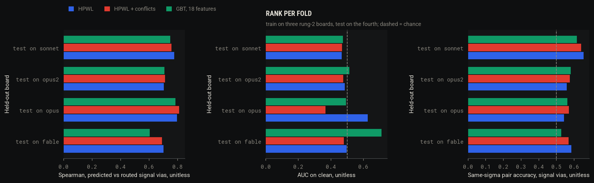
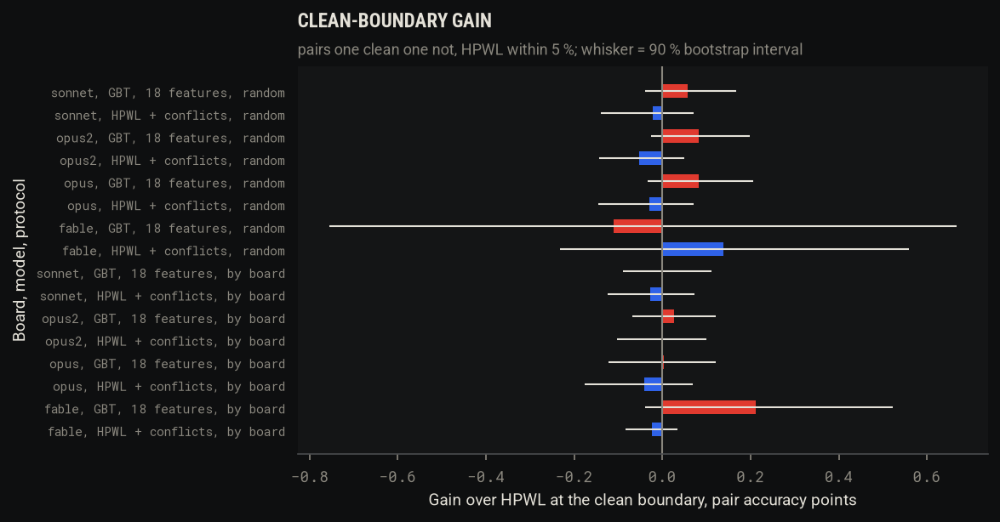
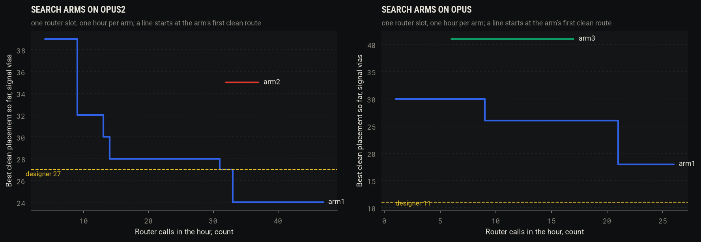

# Spike 1: a learned placement surrogate from router-generated data (2026-11-03)

Issue: [#1](https://github.com/alexchunlin/alex-pcb-skills/issues/1). Branch `spike/1-surrogate` from `main` at 495a3ca
(spikes 3 and 4), with `main` merged again at c77558a (spike 2). Router: KiCadRoutingTools 0.23.7 at
`/tmp/pcb-ref/KiCadRoutingTools` (the bench's install), every call with `PYTHONHASHSEED=0`, at most 4 KRT processes at
once. Boards: the four archived rung-2 placements (`examples/rung2-zener-a1-{opus,sonnet,fable}`,
`examples/rung2-zener-a2-opus`, opus2 below) and the rung-1 Sonnet board (`examples/rung1-zener-a2-sonnet`, r1sonnet).
Work copies under `/tmp/spike1/`; the archived boards were only read. Tables are printed by
`tools/spikes/spike1/report.py` from `tools/bench/results/{placements.jsonl,spike1_rank.json,search.jsonl}`.

## Hypotheses, as corrected by the literature review

- **H1 (rank).** Gradient-boosted trees on hand features rank the router's outcome better than HPWL alone and HPWL plus
  KRT's MPS conflicts: gain over HPWL on same-sigma pairs and at the clean boundary (one placement clean, one not, HPWL
  within 5 %), AUC on clean at or above 0.85, measured held out by board and at random within board. Null (a): no gain
  over HPWL.
- **H2 (search).** The GBT as a move filter inside KRT's own placement search (`place_simple` seeds, which arm (ii)
  judges with `judge_seeds.py --quick 2`) reaches a clean placement at or below the designer's signal vias (27 on
  attempt 2) in fewer router calls than arm (ii). Null (b): arm (ii), or plain random candidates, do as well.
- **H3 (generalisation).** The rank holds on a board the model never saw (the four by-board folds) and on the rung-1
  board, which shares no parts.

## Method

**A. Dataset** (`tools/spikes/spike4/perturb.py run`, spike 4's generator extended). Per rung-2 board the route bench's
input (archived copy, footprints sorted, tracks and vias stripped, pours kept), the archived placement (k = 0) and
perturbations k = 1..149: every footprint except connectors, holes and locked parts moved by N(0, sigma), courtyard and
pad-box overlaps rejected, the placement redrawn while KiCad's DRC shows more overlap-type errors than k = 0. Spike 4's
84 rows (k = 0..20, sigma 1-4 mm) are kept; k = 21..149 use sigma tuned per board from spike 4's clean rates: opus 0.5,
1, 2, 3 mm (none of spike 4's 4 mm rows were clean), sonnet 0.5-4, opus2 1-4, fable 0.25-1.5. Gen and route are
pipelined (`--gen-workers 4`, KRT at 3 or 4 slots; the measuring step runs outside the KRT slot). Label: the bench's
`krt outer` config, KRT's full first pass (no `--quick 2`: it left 11 airwires on opus2 k = 0 in spike 4), refill,
`pcb route measure --drc`: clean = 0 airwires and no new plain DRC error, vias, signal vias, length. Rows in
`tools/bench/results/placements.jsonl` (tag `spike1`, 516 new; `spike1-r1`, 51; `spike1-noise`, 5) with the
placement as (ref, x, y, rot) and the features under `feat`.
Cut: the brief asked for about 250 a board; at the measured 57 s median per route plus measuring, 1,000 rows would have
taken over 4 h at 4 slots, so I cut to 150 a board as the brief says. Generation ran 18:09-22:27 including a 70 min
machine sleep (19:05-20:17) and the fourth slot lent to the noise test and arm (ii).

**Features** (`tools/spikes/spike1/features.py`, pure Python on a board's static geometry from `board_kpy.py`, 20 ms a
placement): HPWL over all nets and over the signal nets (equal to `pcb q conflicts`' number on every row checked),
HPWL by net class (stored per class; the model reads plane, wide-class and Default sums), Manhattan MSTs over the
signal nets, MST edges over a foreign pad, pads per 2 mm cell (max, p90, cells with 6 or more), other parts' pads within
1 mm of a fine-pitch IC, pad pairs of different parts and nets under 0.5 mm and the smallest gap, each declared
`decoupling` row's cap-to-pin distance (mean and excess over max_mm), courtyard area over a foreign outer-layer pour
outline per part (`pour_overlap`; ground floods left out), pads outside every own-net pour on their layer, and KRT's
MPS conflict counts from the row. The models read each feature relative to the board's archived placement,
(f - f0) / (|f0| + 1), so a model trained on three boards reads the fourth on the same scale.

**B. Models and rank test** (`tools/spikes/spike1/surrogate.py`, `rank.py`; scikit-learn 1.9.1 installed into the
repo's `.venv`): `hpwl` (no fit), `hpwl+conflicts` (logistic for clean, linear for signal vias), `linear` (logistic and
ridge on the 18 features), `gbt` (`HistGradientBoostingClassifier` and `Regressor`, depth 3, 200 rounds, rate 0.05, leaf
10). Protocols: by board (train on three, test on the fourth, four folds) and random (5-fold stratified by board and
clean, out-of-fold predictions scored within each board). Metrics per board: Spearman of the predicted signal vias,
AUC on clean, pair accuracy on same-sigma pairs (signal vias; clean) and at the clean boundary, gain = model minus HPWL
with a 90 % bootstrap interval (rows resampled within the board, 300 draws). Pool replay: the search board's own rows
routed in a model's order, calls to the first clean row at or under a target, against (N + 1) / (m + 1) for a random
order. GBT permutation importances over the random folds.

**Label noise.** opus2 k = 9 (clean in spike 4) routed 5 more times with the generator's code under the generator's
load: clean every time, 32 signal vias, 50 vias, 525.748 mm, identical to spike 4's row; wall 28.6-37.0 s. Spread 0.

**C. Search test** (`tools/spikes/spike1/search.py`), one router slot and one hour per arm, the same start (the
archived placement), on opus2 and opus:
- (i) random candidates routed by the real router: the generator's own rows for the board, replayed in generation
  order and cut where the routes' summed wall passes 3,600 s (not run again).
- (ii) KRT's shipped placement search as its skill runs it (`plan-pcb-placement` 3.1-3.7): connectors and holes locked
  with `place_pose.py`, intent from `check_floorplan.py --emit-intent --decaps-from` the archived board, groups = the
  design's own Zener modules (BUCK, DRV, LDO, PWR, CONN) anchored on their chip or connector with near hints
  (`check_groups.py` passes with warnings only), batches of 12 seeds (6 scattered, 6 clustered), the seeds
  `place_simple` names fast-routed by `judge_seeds.py` (our `outer` arguments, `--quick 2` added by the judge), and the
  best by `quick_score.judge_key` full-routed. A seed with more overlap-type DRC errors than the archived placement is
  skipped for the next ranked one.
- kct's search: `kct optimize-placement --seed current --route-check --time-budget 240 --pad-anchored-wirelength`
  (0.26.0, which needs its `placement` extra: installed into `/tmp/spike1-ref/kct`), its result full-routed by KRT.
- (iii) the GBT (fit on all 600 rung-2 rows) as the judge inside arm (ii)'s generator: batches of 24 `place_simple`
  seeds, every named seed scored from its placement and MPS conflicts (no DRC, a few seconds a seed), only the top one
  (highest P(clean), then lowest predicted signal vias) full-routed.
Every router call (quick and full) is a row in `tools/bench/results/search.jsonl`. Each arm's best placement (clean
first, then fewest airwires, then fewest signal vias) and the start were then judged on the plan bench's input
(Alex's stackup: tracks and non-GND pours stripped, In2 GND), routed by `pcb route waves` on the rules plan, scored by
`plan_bench.judges` (refplane, return_via, exposure, irdrop) and the board's `feeds` and `decoupling` rows.
The machine slept 70 min during arm (ii) on opus2; the arm was resumed with its awake elapsed time (2,670 s,
`search.py --elapsed0`), and batch 5's winner, whose quick routes straddled the sleep, was never full-routed.

**D. Generalisation.** The by-board folds of B, and the rung-1 board: its archived placement and 50 perturbations
(sigma 0.5-3 mm), scored by models trained on all four rung-2 boards.

## Results

### A. The dataset

| board | rows | clean | clean % | signal vias median | k = 0 (archived): clean, signal vias |
|---|---|---|---|---|---|
| opus | 150 | 36 | 24 | 30 | yes, 19 |
| sonnet | 150 | 48 | 32 | 25 | no (1 new starved thermal), 22 |
| fable | 150 | 2 | 1 | 25 | no (6 airwires), 18 |
| opus2 | 150 | 38 | 25 | 36 | yes, 34 |
| r1sonnet | 51 | 1 | 2 | 4 | no (1 airwire), 6 |

Three boards land in the 20-60 % band. Fable cannot: its archived placement leaves 6 airwires and at sigma 0.25 mm 1 of
33 rows is clean. Clean by sigma on opus: 11/33 at 0.5 mm, 13/37 at 1, 6/37 at 2, 5/37 at 3; opus2 7/38, 9/37, 12/37,
9/37 at 1-4 mm (no sigma trend). The rung-1 board's first pass leaves one airwire on the archived placement, which
`pcb route auto`'s second pass closes (spike 2 routed it clean in one `auto` call), so this label is harsher there.
Non-clean rows are mostly airwires (opus 103 of 114, opus2 83 of 112), sonnet's mostly new DRC errors.

### B. Rank test

| protocol | test board (clean) | Spearman sv: HPWL / H+C / linear / GBT | AUC clean: HPWL / H+C / linear / GBT | same-sigma sv pairs: HPWL / GBT | same-sigma clean pairs: HPWL / GBT | boundary pairs (n): HPWL / H+C / GBT | GBT gain at boundary [90 % CI] | GBT gain same-sigma sv [90 % CI] |
|---|---|---|---|---|---|---|---|---|
| board | fable (2) | 0.70 / 0.69 / 0.66 / 0.61 | 0.50 / 0.48 / 0.77 / 0.71 | 0.58 / 0.53 | 0.33 / 0.65 | (216) 0.49 / 0.47 / 0.71 | +0.211 [-0.039, +0.523] | -0.058 [-0.113, -0.001] |
| board | opus (36) | 0.80 / 0.81 / 0.78 / 0.79 | 0.63 / 0.37 / 0.44 / 0.49 | 0.54 / 0.56 | 0.41 / 0.53 | (1913) 0.51 / 0.47 / 0.52 | +0.004 [-0.122, +0.121] | +0.019 [-0.047, +0.072] |
| board | opus2 (38) | 0.70 / 0.71 / 0.61 / 0.71 | 0.49 / 0.48 / 0.55 / 0.51 | 0.56 / 0.58 | 0.54 / 0.54 | (1928) 0.48 / 0.48 / 0.51 | +0.026 [-0.068, +0.121] | +0.024 [-0.017, +0.071] |
| board | sonnet (48) | 0.78 / 0.76 / 0.76 / 0.75 | 0.47 / 0.47 / 0.47 / 0.47 | 0.65 / 0.62 | 0.51 / 0.48 | (2656) 0.48 / 0.45 / 0.48 | -0.002 [-0.089, +0.111] | -0.039 [-0.087, +0.009] |
| random | fable (2) | 0.70 / 0.68 / 0.68 / 0.67 | 0.50 / 0.56 / 0.74 / 0.37 | 0.58 / 0.55 | 0.33 / 0.08 | (216) 0.49 / 0.63 / 0.38 | -0.111 [-0.756, +0.667] | -0.038 [-0.087, +0.011] |
| random | opus (36) | 0.80 / 0.81 / 0.78 / 0.78 | 0.63 / 0.38 / 0.56 / 0.60 | 0.54 / 0.53 | 0.41 / 0.53 | (1913) 0.51 / 0.48 / 0.59 | +0.083 [-0.033, +0.205] | -0.012 [-0.082, +0.042] |
| random | opus2 (38) | 0.70 / 0.71 / 0.70 / 0.71 | 0.49 / 0.46 / 0.46 / 0.57 | 0.56 / 0.58 | 0.54 / 0.56 | (1928) 0.48 / 0.43 / 0.56 | +0.082 [-0.025, +0.198] | +0.025 [-0.029, +0.076] |
| random | sonnet (48) | 0.78 / 0.77 / 0.76 / 0.77 | 0.47 / 0.47 / 0.50 / 0.53 | 0.65 / 0.65 | 0.51 / 0.52 | (2656) 0.48 / 0.46 / 0.54 | +0.058 [-0.039, +0.168] | -0.001 [-0.045, +0.043] |
| r1 | r1sonnet (1) | 0.30 / 0.02 / -0.22 / 0.33 | 0.70 / 0.52 / 0.62 / 0.80 | 0.51 / 0.52 | 0.82 / 1.00 | (43) 0.65 / 0.58 / 0.77 | +0.116 [+0.023, +0.220] | +0.008 [-0.103, +0.100] |

Columns per model: HPWL, HPWL + conflicts (H+C), linear on the 18 features, GBT on the same. Same-sigma pairs: 2,000 to
2,600 signal-via pairs and 36 to 1,021 clean pairs a board. Fable has 2 clean rows and the rung-1 board 1, so their clean
columns rest on one or two placements.

Feature importances (GBT, permutation, random folds): for clean `pads_off_pour` 0.111 AUC, `min_gap` 0.028,
`hpwl_wide` 0.024, `pour_foreign_mm2` 0.021, `foreign_pad_cross` 0.020, the rest under 0.01; for signal vias
`mst_signal` 0.156 R2, `pads_off_pour` 0.105, `hpwl_default` 0.029, `conflicts` 0.026, `foreign_pad_cross` 0.019.

Pool replay (each search board's 149 perturbed rows routed in the model's order; router calls to the first hit):

| target | hits in the pool | random order (expected) | HPWL | HPWL + conflicts | linear | GBT |
|---|---|---|---|---|---|---|
| opus2:designer <= 27, model fit on the other three boards | 3 of 149 | 37.5 | 11 | 60 | 74 | 60 |
| opus2:designer <= 27, out-of-fold, same board in training | 3 of 149 | 37.5 | 11 | 52 | 38 | 43 |
| opus2:router_k0 <= 34, model fit on the other three boards | 16 of 149 | 8.8 | 8 | 7 | 46 | 1 |
| opus2:router_k0 <= 34, out-of-fold, same board in training | 16 of 149 | 8.8 | 8 | 50 | 5 | 9 |
| opus:designer <= 11, model fit on the other three boards | 0 of 149 | 150.0 | never | never | never | never |
| opus:designer <= 11, out-of-fold, same board in training | 0 of 149 | 150.0 | never | never | never | never |
| opus:router_k0 <= 19, model fit on the other three boards | 6 of 149 | 21.4 | 17 | 91 | 51 | 54 |
| opus:router_k0 <= 19, out-of-fold, same board in training | 6 of 149 | 21.4 | 17 | 65 | 28 | 17 |

### C. Search test

| board | arm | router calls in the hour (quick + full) | full routes clean | best clean: signal vias, mm | calls to first clean | calls to clean <= router on start | calls to clean <= designer |
|---|---|---|---|---|---|---|---|
| opus2 | arm1 random (replayed) | 47 (0 + 47) | 11 of 47 | 24, 652.0 | 4 | 9 (<= 34) | 31 (<= 27) |
| opus2 | arm2 KRT place_simple + judge_seeds | 37 (30 + 7) | 2 of 7 | 35, 578.9 | 32 | none (<= 34) | none (<= 27) |
| opus2 | arm3 GBT filter in place_simple | 16 (0 + 16) | 0 of 16 |  | none | none (<= 34) | none (<= 27) |
| opus2 | kct CMA-ES --route-check | 1 (0 + 1) | 0 of 1 |  | none | none (<= 34) | none (<= 27) |
| opus | arm1 random (replayed) | 26 (0 + 26) | 8 of 26 | 18, 465.5 | 1 | 21 (<= 19) | none (<= 11) |
| opus | arm2 KRT place_simple + judge_seeds | 69 (60 + 9) | 0 of 9 |  | none | none (<= 19) | none (<= 11) |
| opus | arm3 GBT filter in place_simple | 17 (0 + 17) | 1 of 17 | 41, 767.7 | 6 | none (<= 19) | none (<= 11) |

Router calls count quick (`--quick 2`, arm ii's judge) and full routes alike; arm (i)'s hour is its routes' summed wall
(47 routes on opus2, 26 on opus at their 57-140 s); arms (ii) and (iii) ran live, one KRT process each. On opus2
`place_simple` named 1 to 5 of 12 seeds per batch (the rest left a part illegal) and the batch's best seed carried 0 to 2
`check_floorplan --intent` errors; on opus it named 6 of 12, floorplan-clean, every batch. Arm (iii) scored 3 to 12 of
24 seeds per batch on opus2 and 17 to 22 on opus; the top seed's P(clean) was 0.02-0.41 (the training rows are
perturbations of the designer's placement, and KRT's global seeds sit outside them).

Dev judges on Alex's stackup (`pcb route waves`, rules plan) for the start and each arm's best:

| board | placement | clean | signal vias | length mm | VIN mW | bucket-3 off ground mm | return-via bad | exposure mm | currents fails | feeds fails | decoupling fails |
|---|---|---|---|---|---|---|---|---|---|---|---|
| opus2 | start | yes | 47 | 642.235 | 92.93 | 0 | 8 | 0.8 | 2 | 3 of 9 | 0 of 19 |
| opus | start | yes | 32 | 556.692 | 249.7 | 0 | 9 | 4.3 | 4 | 1 of 1 | 3 of 16 |
| opus2 | arm1 | yes | 45 | 669.558 | 84.56 | 0.5 | 10 | 4.4 | 2 | 1 of 9 | 5 of 19 |
| opus2 | arm2 | no | 40 | 455.374 | 404.81 | 0 | 6 | 2.9 | 3 | 1 of 9 | 2 of 19 |
| opus | arm1 | yes | 52 | 658.27 | 222.52 | 0 | 12 | 10.8 | 4 | 0 of 1 | 5 of 16 |
| opus | arm2 | yes | 37 | 498.497 | 242.3 | 0 | 9 | 11.6 | 4 | 0 of 1 | 5 of 16 |
| opus2 | arm3 | no | 71 | 755.033 | 338.35 | 0 | 7 | 14.3 | 2 | 2 of 9 | 10 of 19 |
| opus | arm3 | no | 59 | 688.76 | 114.14 | 0 | 12 | 32.2 | 4 | 0 of 1 | 7 of 16 |

The judges and the bench label disagree. On opus the random arm's best (18 signal vias on the bench, 465 mm) routes on
Alex's stackup with 52 signal vias against the start's 32, and 10.8 mm of exposure beside SW against 4.3; on opus2 the
random arm's best (24 on the bench) gives 45 against 47 with 0.5 mm of a bucket-3 net off ground, 4.4 mm of exposure
against 0.8 and 5 decoupling fails against 0. The search arms' placements are worse than the designer's on exposure
and decoupling in every case; none beats the start on the judges Alex ranks by.

kct: CMA-ES from the current placement kept the warm start (no candidate better in 333 iterations); its route check
ran 3 kct routes in 1,923 s (20 of 28 nets on the incumbent, 130 kct DRC errors), rejected the optimizer's result
(19/28) and accepted the decoupling snap (6 caps moved onto their pins), which kct then calls INFEASIBLE (15.3 mm2
overlap). KiCad's DRC finds no new overlap-type error on it, and KRT routes it with 1 airwire, 28 signal vias, 546 mm.
One kct run took 32 min, so the kct arm is that one call, not an hour of them.

### D. Generalisation

By board: in the folds above every model's AUC on clean sits at 0.37-0.63 on the three boards with clean rows, and
GBT's boundary gain at -0.002 to +0.026. On the rung-1 board (51 rows, 1 clean): Spearman of signal vias HPWL +0.30,
HPWL + conflicts +0.02, linear -0.22, GBT +0.33; the single clean row makes its AUC (GBT 0.80, HPWL 0.70) and its
boundary pairs (43) one placement's worth of evidence.

## Verdicts

- **H1, rank: drop (null (a) holds).** Held out by board, GBT's gain over HPWL at the clean boundary is +0.004
  (opus), +0.026 (opus2) and -0.002 (sonnet) pair-accuracy points, every 90 % interval spanning 0 (widest -0.122 to
  +0.121); on same-sigma signal-via pairs -0.039 to +0.024. At random within board, where the model has seen the board,
  the boundary gain is +0.058 to +0.083, intervals still spanning 0. AUC on clean is 0.47-0.57 for GBT and 0.47-0.63
  for HPWL against the 0.85 bar: on perturbations of one placement, whether KRT's first pass closes the last one or two
  connections is not readable from placement-level features, HPWL included. HPWL alone ranks signal vias at Spearman
  +0.70 to +0.80 and nothing fitted beats it. HPWL + conflicts adds nothing either (boundary gain -0.042 to 0.000).
  This is kct's calibration result (0.743 against HPWL's 0.749) on a third toolchain, with 600 rows instead of 85.
- **H2, search: drop (null (b) holds, decision rule not met).** Neither arm (ii) nor arm (iii) reached a clean
  placement at or below the designer's 27 signal vias on opus2, or even the router's 34 on the archived placement; on
  opus neither reached 19. So the surrogate does not beat arm (ii) on router calls to the target: both are at "never in
  an hour". Inside KRT's search the GBT filter found 0 clean in 16 full routes on opus2 (arm ii: 2 clean of 7, best 35)
  and 1 clean in 17 on opus (41 signal vias; arm ii: 0 of 9). The arm that reached the target is plain random
  perturbation of the designer's placement: 27 or fewer at call 31 on opus2 (best 24), 19 or fewer at call 21 on opus.
  Ordering that same random pool by raw HPWL reaches 27 or fewer in 11 calls, against 37.5 expected at random and 43 to
  60 by the GBT (pool replay). On the judges Alex ranks by, no arm's best beats the designer's placement (C).
- **H3, generalisation: drop.** The by-board folds show no gain on any unseen rung-2 board (H1). On the rung-1 board
  GBT ranks signal vias at Spearman +0.33 against HPWL's +0.30 and HPWL + conflicts' +0.02; its boundary gain of +0.116
  [+0.023, +0.220] comes from the board's one clean placement among 51, which is one placement's evidence.
- **Label noise: none.** Five repeats of one placement gave identical clean, vias, signal vias and length (and spike
  4's row); the router is deterministic under 3 to 4 parallel jobs, so the null is not a noise floor.

## Corrections found on the way

- The bench label is not the label Alex ranks by. Placements that the route bench (`krt outer`, the archived In2
  power plane, pours kept) scores best come out worse than the designer's on Alex's stackup through `pcb route waves`
  (C: opus 52 against 32 signal vias, exposure 10.8 against 4.3 mm). A future placement score has to be fitted to the
  waves-plus-judges label (about 90 s a placement), not to the one-pass bench row.
- Clean is the hard half. Every model, HPWL included, sits near AUC 0.5 on clean within a board; the issue's 0.85
  bar came from kct's set, which mixes boards and sigmas where clean rate itself moves.
- kct 0.26.0 `optimize-placement` fails at once without its `placement` extra (`cmaes`), which the machine's
  `uv tool` install lacks; with it, one `--route-check` run on opus2 is 32 min (3 kct routes).
- KRT's `place_simple` on opus2 (fixed connectors, 50 x 40 mm) leaves a part illegal in 7 to 11 of 12 seeds.
- The rung-1 board's archived placement leaves 1 airwire after KRT's first pass; `pcb route auto` closes it, so spike
  2's clean counts and this spike's are on different labels.
- The machine slept 70 min mid-run (19:05-20:17): long bench runs now go under `caffeinate -i -s -w <pid>`.

## Why not the existing code

- **The ranker.** HPWL is `pcb q conflicts`' own number (`pcbq.hpwl`), and KRT's MPS conflict count is spike 4's
  `pcb q conflicts`; both are the baselines above, configured as they ship. KRT's own placement cost
  (`placement/simple.py`: MST wire, crossings, decaps, halo, pad hits, congestion) is the objective arm (ii) anneals, and
  its terms are in the feature set (MST, foreign-pad crossings, halo, congestion, decap distance). kct's
  `fom_features.py` set (pin density, Steiner length, pin-to-pin min, decoupling median) overlaps the same quantities.
  What none of them has is a fitted combination; the fit is the only new thing here, and it does not beat raw HPWL out
  of sample (B), as kct's own calibration found (0.743 against 0.749).
- **The search.** Arm (ii) is KRT's shipped `place_simple` + `judge_seeds.py` run as its skill says, and kct's
  `optimize-placement --route-check` ran as shipped (once its `placement` extra was installed). The only new code is
  the harness that counts router calls and the GBT scorer in arm (iii). Measured gap: on these two boards neither
  shipped search found a clean placement under the router-on-start count in its hour (C), while random perturbations of
  the designer's placement did; that is a property of global re-placement against fixed pours and connectors, not
  something a surrogate fixes.
- **The generator.** spike 4's `perturb.py` / `perturb_kpy.py`, extended (per-board sigma, a pipelined `run`, `noise`,
  `--apply`), not replaced.
- **Spike 2's prior-seeded placements** (rung-1 board, satellites of one IC from corpus offsets: 33/50 clean against
  17/50 uniform with `pcb route auto`, router calls per clean route 1.52 against 2.94) were not added as a fourth arm:
  the priors exist for the LSM6DS3's caps, and seeding the DRV8874 and TPS54620 satellites on the rung-2 boards needs
  role tables for parts the corpus has few instances of, more than the 30 minutes allowed. Its uniform baseline places
  three caps anywhere on the board, which is far from this spike's sigma-limited perturbations.

## What to merge

- `tools/spikes/spike1/` (generator glue, features, models, rank test, search harness, report) as the record.
- `tools/spikes/spike4/perturb.py` and `perturb_kpy.py` (the extensions above; spike 4's commands unchanged).
- `tools/bench/results/placements.jsonl` (656 labelled rows with features; the 84 spike-4 rows gained a `feat` key and
  nothing else), `spike1_rank.json`, `search.jsonl`.
- `tools/verify_all.sh` section 33 (the rank numbers from the committed rows, the features recomputed on the attempt-2
  board; 9 s).
- This report and `docs/img/spikes/1-*.png`.
- `tools/bench/results/replay.jsonl` (the replay rows of this branch: 24 labels, recall 14 of 17 catchable, 0 false
  fails).
- Not merged as a tool: no surrogate in `pcb`, no GBT in the search.

verify_all `--changed`: 20 passed, 0 failed (units 33 and verify_select). `python3 -I tools/bench/replay.py`: 0 false
fails.
