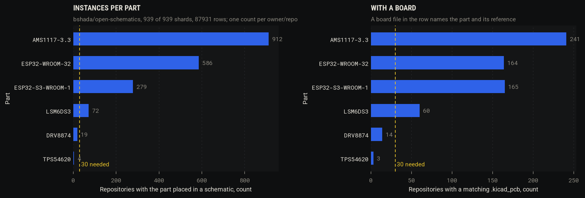
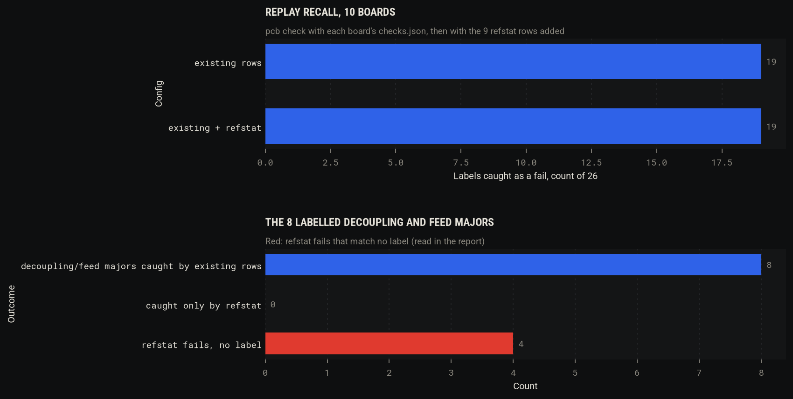
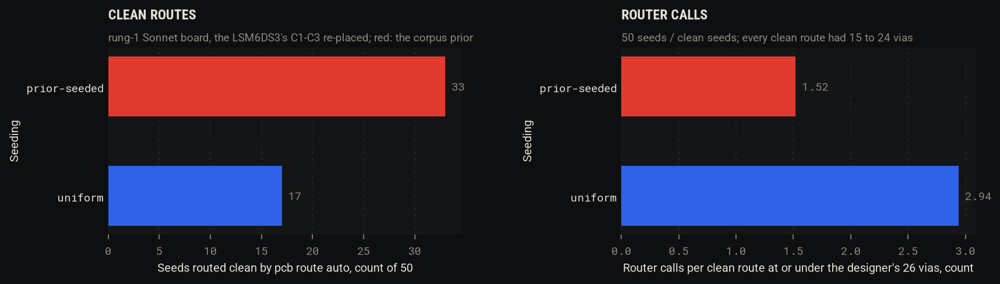
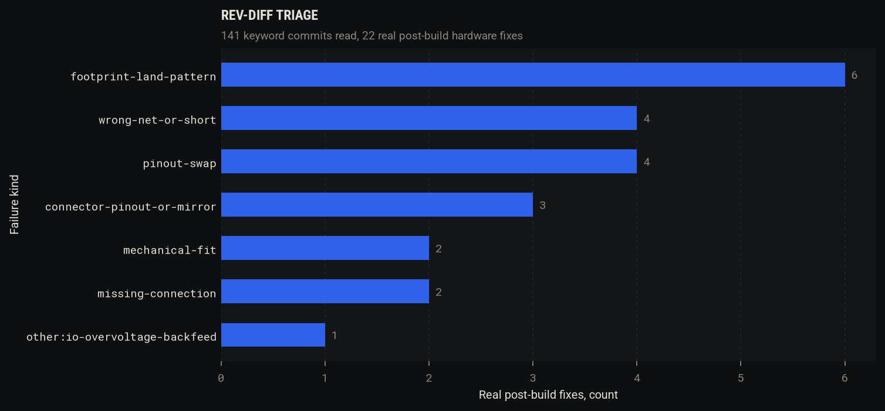

# Spike 2: a public KiCad corpus for reference circuits, placement priors and rev-diff errata

Issue: [#2](https://github.com/alexchunlin/alex-pcb-skills/issues/2). Branch `spike/2-corpus`, from `main` at 46f9be9 with
`main` at aed4bd8 merged in. Run 2026-11-03. Everything downloaded stayed under `/tmp/spike2-corpus/`
(peak 1.5 GB; the parquet shards were streamed by column and never written to disk), and every script that read it ran
from the repo with `python3 -I`, KiCad's Python through `pcb py`, or `kicad-cli` with the file as an argument.

## Hypotheses (as corrected by the literature review)

The review on the issue replaced the scrape with bshada/open-schematics on Hugging Face, dropped the parser work and
the licence filter, and set the keyword fix-commit precision at about 0.44. What was tested:

1. **Reference circuits.** At least 30 parseable instances exist for the common parts (AMS1117-3.3, LSM6DS3TR-C,
   ESP32-WROOM-32, ESP32-S3-WROOM-1; DRV8874 and TPS54620 counted only), and a `refstat` row built from their
   decoupling and feed statistics catches, on the replay bench, at least one labelled rung-2 decoupling or feed major
   that no existing row catches, with 0 false fails. Null: under 30, or no recall added.
2. **Placement priors.** Satellites (bulk cap, bypass cap, inductor, divider resistors) seeded from the corpus offsets
   route cleaner, or reach the designer's via count in fewer router calls, than uniform seeds in the same box. Null: no
   difference. Skipped if fewer than 30 LSM6DS3 instances have a board.
3. **Rev diffs.** A triage of 50 real post-build fixes among keyword commits (fix, rev, errata, bodge, rework, wrong,
   swap, reversed) on `.kicad_pcb`/`.kicad_sch` yields at least 10 distinct tool-catchable failure kinds not already in
   `tools/bench/labels.json`. Null: fewer than 10, or not catchable.

## Method

**A. Corpus scan** (`tools/corpus/scan.py`, 6 to 8 parallel shard reads through `huggingface_hub.HfFileSystem` and
pyarrow column projection). Pass 1 reads `name`, `schematic` and `extensions_used` of every shard (about 2 MB of a 77
to 400 MB shard) and finds placed symbols by lib_id or Value: v6+ s-expression schematics after `lib_symbols`, legacy
`.sch` from the `$Comp` blocks. Part regexes are in `skills/kicad-design/scripts/pcbrefstat.py` (`PART_RX`); LSM6DS3
covers LSM6DS3, LSM6DS3TR and LSM6DS3TR-C (one LGA-14 pinout, variant recorded per hit). Each hit's schematic text is
kept under `/tmp/spike2-corpus/sch/`. Pass 2 reads the `pcb_files` column of the shards whose hits need a board and
keeps the board whose text names the part and one of its references. The stop rule (every common part at 200 projects)
never fired because LSM6DS3 ends at 100, so all 939 shards were read. Licences: one GraphQL query per 50 repos
(`licenseInfo.spdxId`). Index: `tools/bench/data/corpus-index.jsonl`, one line per (schematic row, part), no contents.

**B. Reference circuits** (`tools/corpus/refstat.py`, `tools/corpus/boardmeasure.py`). `kicad-cli sch export netlist`
on every hit schematic; per instance of the part and per canonical pin (`pcbrefstat.canon_pin`: AMS1117 `VI`/`VIN`/`IN`
all become VIN), the passives on the pin's net (hop 1) as `CLASS:BAND:OTHER` (class from the reference prefix, value
band, what the other pin lands on: GND, another pin of the same IC as `IC:<pin>`, a power-looking net, or a signal) and
the passives one series part further (hop 2). Capacitors also count at a coarse band (bypass under 1 uF, bulk 1 uF and
up) and at any value. One instance per (repo, part, reference), so forks and repeated sheets count once. Support is the
share of instances with the pin connected that show the feature. Where a board matched, the pad-to-pad distance from
the IC pin to the nearest part realising the feature (KiCad's Python over the corpus board). A row is emitted for each
pin whose most specific dominant feature has support 0.70 or more over 30 or more instances, with `max_mm` the corpus
p90 distance where 20 or more boards measured it; signal-side features (an LED resistor on VOUT, a pull-up to an MCU
pin) are counted and not emitted, and a two-pin part seen from both of its IC pins is one row. The new pcbcheck kind
`refstat` checks a declared row; `tools/spikes/spike2/refstat_bench.py` runs `pcb check` on the 10 archived boards
with each board's own `checks.json`, then with every row added, and scores both with `replay.py`'s `score`.

**C. Placement priors** (`tools/spikes/spike2/placement_test.py`, `seed_place.py`). From the measured boards, each
satellite's centre in the IC's own frame (the footprint's pad pattern fitted to its board pads, so rotation and
mirroring are undone) and its rotation relative to the IC, modulo 180. A satellite of a role (pin, class) is the
nearest part of that class on the pin's net; every other cap on a shared 3V3 rail belongs to another IC. VDD and VDDIO
on one net are one role. The routing test strips the copper of `examples/rung1-zener-a2-sonnet` (zones kept), moves
the LSM6DS3's three capacitors C1, C2, C3 (100 nF, 100 nF, 1 uF; the IC, connectors, jumpers and pull-ups stay) 50
times from the prior (a random corpus satellite of the same role) and 50 times uniformly over the outline's bounding box
inset 1 mm, rejecting draws whose courtyard box overlaps another footprint's, then routes each seed with KRT `--quick 2`
(the seed judge) and with `pcb route auto` (the production route: KRT pass, refill, dual DRC, second pass), at most
three KRT processes at once.

**D. Rev diffs** (`tools/corpus/revdiff.py`). Code search `footprint extension:kicad_pcb size:A..B` over seven size
slices (1 to 384,000 bytes) at 6.5 s per request, forks dropped, repos taken round-robin over the slices; then
`commits?path=` on each repo's board and its sibling `.kicad_sch`/`.sch`; keyword commits (non-merge) sampled with at
most 3 per repo; each commit's `files[].patch` through the API, condensed to the lines that name references, values,
footprints, lib_ids, labels and nets. Three reader sub-agents triaged 47 digests each against one brief (kinds
vocabulary, the rows that exist, the 41 bench labels); I merged them and marked 10 for Alex to spot-check.

## Results

### A. Instances per part

All 939 shards, 87,931 rows: 40,033 KiCad 6+ schematics, 22,212 legacy `.sch`, 25,686 rows whose schematic column is
not a KiCad file. Pass 1 took 1,667 s (27.8 min). Pass 2 read the `pcb_files` column of 366 shards for 1,036 hits in
four runs totalling about 2.0 h wall (Hugging Face slowed the large column reads from 5 s to 30-70 s per shard after the
first hour; one run hit the 30 min task limit at shard 180 and the next resumed from the index). Board matching ran for
every LSM6DS3, DRV8874 and TPS54620 hit and for the first 300 board-bearing hits of each other part; the rest carry
`has_pcb_ext` only.

| Part | Projects (schematic rows) | Repos | Placed symbols | KiCad 6+ / legacy rows | Rows with a `.kicad_pcb` | Board checked / matched (repos) | Netlists that parse and hold the part | Instances after (repo, ref) dedupe |
|---|---|---|---|---|---|---|---|---|
| AMS1117-3.3 | 1,289 | 912 | 1,339 | 1,027 / 262 | 1,232 | 300 / 264 (241) | 1,007 | 778 |
| ESP32-WROOM-32 | 816 | 586 | 829 | 621 / 195 | 773 | 300 / 245 (164) | 589 | 454 |
| ESP32-S3-WROOM-1 | 393 | 279 | 393 | 390 / 3 | 376 | 300 / 268 (165) | 379 | 275 |
| LSM6DS3 (TR, TR-C) | 100 | 72 | 101 | 73 / 27 | 98 | 98 / 83 (60) | 73 | 56 |
| DRV8874 | 34 | **19** | 47 | 25 / 9 | 34 | 34 / 23 (14) | not run (under 30) | |
| TPS54620 | 4 | **4** | 4 | 4 / 0 | 4 | 4 / 3 (3) | not run | |

- `kicad-cli sch export netlist` ran on 2,380 hit schematics: 11 exports failed outright (0.5 %), and every legacy
  `.sch` gave a netlist without the part (the row carries no `-cache.lib`, so KiCad 10 loads the symbols empty): 487
  rows, all legacy. KiCad 6+ files give a netlist holding the part for 98.7 to 100 % of hits per part. Variants: LSM6DS3 81 rows,
  LSM6DS3TR-C 15, LSM6DS3TR 4; AMS1117-3.3 also written `-3V3` (20) and `-33` (3).
- Licences over the 1,679 unique repos of all hits (SPDX from GitHub): no licence 913 (54 %), MIT 256, GPL-3.0 167,
  NOASSERTION 83, repo gone or renamed 64, Apache-2.0 40, CERN-OHL-S-2.0 33, CC-BY-SA-4.0 20, CC0 19, CERN-OHL-P 15,
  the rest under 15 each. Recorded per hit in the index; nothing filtered; only counts are published.
- Disk: 1.5 GB peak under `/tmp/spike2-corpus/` (hit schematics 365 MB, matched boards, netlists), far under the 20 GB
  cap; the shards were never on disk, so there was nothing to delete.

### B. Statistical reference circuits

Rows at support 0.70 or more (`tools/bench/data/refstat-rows.json`); distance is pad to pad from the IC pin to the
nearest part realising the pattern, on the matched boards:

| Part | Pin | Dominant pattern | Support | Instances | Boards measured | Median distance, mm | p90 (`max_mm`), mm |
|---|---|---|---|---|---|---|---|
| AMS1117-3.3 | VIN | cap 1 uF or more to GND | 0.81 | 772 | 186 | 3.34 | 12.46 |
| AMS1117-3.3 | VOUT | cap 1 uF or more to GND | 0.85 | 768 | 192 | 5.31 | 12.99 |
| LSM6DS3 | VDD | 100 nF to GND | 0.88 | 51 | 32 | 1.85 | 5.67 |
| LSM6DS3 | VDDIO | 100 nF to GND | 0.85 | 53 | 32 | 1.67 | 5.26 |
| ESP32-WROOM-32 | 3V3 | any cap to GND | 0.77 | 421 | 134 | 3.83 | 32.42 |
| ESP32-WROOM-32 | EN | resistor to the module's 3V3 | 0.83 | 349 | 120 | 15.4 | 37.26 |
| ESP32-S3-WROOM-1 | 3V3 | cap 1 uF or more to GND | 0.80 | 265 | 125 | 6.8 | 39.25 |
| ESP32-S3-WROOM-1 | EN | resistor to the module's 3V3 | 0.83 | 238 | 123 | 9.35 | 33.29 |
| ESP32-S3-WROOM-1 | EN | any cap to GND | 0.80 | 238 | 108 | 9.91 | 31.01 |

Patterns under 0.70, for scale: AMS1117 VIN 10 uF band 0.46, VOUT 100 nF 0.68, VOUT 10 uF 0.54, VOUT 22 uF 0.42;
ESP32-WROOM-32 EN cap to GND 0.69, 3V3 100 nF 0.58, IO0 pull-up 0.42; LSM6DS3 bulk cap 0.49, SDA/SCL pull-ups 0.43.
No two-hop pattern reaches 0.70 on any pin.

Replay bench (`tools/spikes/spike2/refstat-bench.json`; 10 boards, each board's own `checks.json`, then all 9 rows added):

| | Existing rows | Existing + 9 refstat rows |
|---|---|---|
| labels caught as a fail (rows scope) | 19 of 26 | 19 of 26 |
| labelled decoupling and feed majors (R2-O-2, R2-O-3, R2-S-1, R2-S-2, R2-F-3, R2-F-4, R2A2-O-1, R2A2-O-2) | 8 of 8 | 8 of 8, **0 new** |
| refstat rows evaluated / failing | | 30 / 4 |
| fails matching no label | 0 | **4** (2 findings on plink-v1, the same 2 on plink-fixed) |

- All 8 labelled decoupling and feed majors are on the DRV8874's VM pin and the rung-2 feed paths. The DRV8874 has 19
  repos in the corpus, so it gets no row, and the existing `decoupling` and `feeds` rows already catch all 8.
- The 4 unlabelled fails: the Plink's ESP32-S3 (U1) EN pin has no capacitor to GND (80 % of 238 corpus designs have
  one; Espressif's reference circuit puts an RC delay on CHIP_PU), and its pull-up R9 sits 48.5 mm away (corpus p90
  33.3 mm). Both are real deviations from the reference circuit on a board that shipped and worked; nobody reported a
  reset problem, so they stay unlabelled and count as false fails under the bench's rule.
- The corpus distances are hobby distances: LSM6DS3 100 nF p90 5.3 to 5.7 mm against our `decoupling_max_mm` default of
  2.0, AMS1117 bulk p90 12.5 to 13 mm. Every archived board passes them; the rung-1 C3 at 2.639 mm (R1-Z1-F3, caught by
  `decoupling` at 2.0) is far inside 5.67. A distance learned from this corpus is looser than the datasheet's.
- The rows that apply on the 8 archived boards carrying one of the parts: AMS1117 VIN/VOUT bulk caps at 1.37 to 8.55 mm
  and LSM6DS3 100 nF at 1.05 to 2.15 mm, all pass.

### C. Placement priors

Nearest satellite per (IC, pin, class), pad to pad, from the matched boards (`tools/spikes/spike2/priors-summary.json`):

| IC | Satellite | n | Distance median, mm | IQR, mm | p90, mm | Rotation 0 / 90 relative to the IC |
|---|---|---|---|---|---|---|
| AMS1117-3.3 (241 instances) | bulk cap (1 uF+) | 365 | 4.46 | 2.78-6.20 | 12.1 | 0.50 / 0.50 |
| | bypass cap | 286 | 7.29 | 4.33-17.9 | 29.5 | 0.46 / 0.52 |
| | inductor or ferrite | 53 | 14.9 | 11.8-22.2 | 32.7 | 0.64 / 0.34 |
| | resistor (LED, pull-up) | 243 | 12.0 | 6.83-21.6 | 34.1 | 0.52 / 0.47 |
| LSM6DS3 (37 instances) | bypass cap (100 nF) | 35 | 1.70 | 1.22-3.30 | 5.2 | 0.71 / 0.29 |
| | bulk cap | 24 | 9.14 | 5.72-20.1 | 25.1 | 0.38 / 0.58 |
| | inductor or ferrite | 8 | 23.5 | 18.0-29.0 | 29.0 | 0.75 / 0.12 |
| | resistor (pull-ups) | 42 | 4.43 | 2.67-10.5 | 22.3 | 0.40 / 0.60 |

No AMS1117-3.3 design has a divider (fixed output); its resistors are LED and pull-up resistors on the rail. LSM6DS3 has
37 deduplicated instances with a measured board (over 30), so the routing test ran.

Routing test on `examples/rung1-zener-a2-sonnet`, C1-C3 re-placed (`tools/spikes/spike2/placement-results.jsonl`):

| Seeding | Seeds | Clean after `pcb route auto` | Vias of clean routes, median (range) | Router calls per clean route at or under the designer's 26 vias | Clean at or under 19 vias | KRT `--quick 2` open pad pairs, median |
|---|---|---|---|---|---|---|
| corpus prior | 50 | **33 (0.66)** | 19 (16-22) | **1.52** | 17 | 4 |
| uniform in the outline box | 50 | 17 (0.34) | 18 (15-24) | 2.94 | 12 | 4 |

- Fisher's exact test, 33/50 against 17/50: p = 0.0025 two-sided. Every non-clean seed is 1 to 3 airwires left after
  the second pass; the router added no DRC error (2 uniform seeds have 1 and 3 plain errors).
- The designer's own placement, stripped and routed by `pcb route auto`, is clean in one call at 19 vias (26 in the
  designer's hand copper). The prior gets a clean route in 1.52 calls on average and one at or under 19 vias in 2.94;
  uniform needs 2.94 and 4.17. Via counts do not separate the two (medians 19 and 18): the prior buys routability, not
  fewer vias.
- KRT's `--quick 2` seed judge leaves the same 4 pad pairs open on all 100 seeds (the plane nets it defers), so on this
  board it carries no signal; the production route was the judge.

### D. Rev-diff triage

| Step | Count |
|---|---|
| repos from code search (7 size slices, forks dropped), first set | 200 |
| commits touching the board or its sibling schematic, first 200 repos | 705 (97 repos have exactly 1) |
| keyword commits, non-merge, first 200 repos | 90 |
| repos after extending with search pages 3 to 5 (90 keyword commits cannot give 50 real fixes at 0.44) | 450 |
| commits on board or schematic / keyword commits, 450 repos | 1,357 / 160 |
| sampled with at most 3 per repo, all read | 141 |
| real post-build fixes (high 7, medium 15) | **22 (precision 0.16)**; 11 of 76 in the first 200 repos |

| Kind | Real fixes | Tool-catchable by | In labels.json already | Commits (S = spot-check) |
|---|---|---|---|---|
| footprint land pattern (pitch, package, module row spacing) | 6 | proposed `footprint-vs-datasheet` (6) | no | [Miceuz/i2c-moisture-sensor@e7ada2b](https://github.com/Miceuz/i2c-moisture-sensor/commit/e7ada2b4809c7364b761056fb41da0cbe510f6c0) S, [yangosoft/caraccel@82aad77](https://github.com/yangosoft/caraccel/commit/82aad77804f34068e5e28ce8998ca1440d831757) S, [HarmonInstruments/JTAG_SWD@8da4548](https://github.com/HarmonInstruments/JTAG_SWD/commit/8da45486c2e046a9f8dd7bee0a1df1edfaa3d7a6), [HackableElectronics/TLV493D-rod@d30cab7](https://github.com/HackableElectronics/TLV493D-rod/commit/d30cab7859ca06827370249cdb8144ce731c79d4), [KuguHome/amber-wmbus-HAT@5558b42](https://github.com/KuguHome/amber-wmbus-HAT/commit/5558b42808ebed068ef2eb6328b0fd46753efce7), [torvalds/GuitarPedal@63b4862](https://github.com/torvalds/GuitarPedal/commit/63b48622dd236203e817b0ef3085568ea6a0948c) |
| wrong net or short | 4 | `erc` 1, `pinmaps` 1, `drc` 1, proposed `tvs-return-to-gnd` 1 | 3 of 4 | [mawoka-myblock/td-free@b4a703a](https://github.com/mawoka-myblock/td-free/commit/b4a703a8acdd80e5c62bdb773103834451d88045) S (cap in series with VDD), [Ottercast/OtterCastAudioV2@7a81cb3](https://github.com/Ottercast/OtterCastAudioV2/commit/7a81cb3b6428d6aa9ae0d56c7474165dbebe3f88) S (TVS returns on +3V3/+5V), [c0pperdragon/A-VideoBoard@d917ee0](https://github.com/c0pperdragon/A-VideoBoard/commit/d917ee026821802509c9557fe2905cc8b230d28b), [kvanderlaag/7Up-Extruder-PCB@35ca098](https://github.com/kvanderlaag/7Up-Extruder-PCB/commit/35ca0986024968bb7b7bcef41f84c75d00d74ad1) |
| pinout swap (TDI/TDO, D+/D-, key matrix) | 4 | `pinmaps` 2, `connectors` 2 (with a declared map) | yes (PLINK-IMU) | [aeberbach/A600KB@462b1f9](https://github.com/aeberbach/A600KB/commit/462b1f950a7a6f0ec7972bfbd01c2e75af459d10) S, [HarmonInstruments/JTAG_SWD@dceb316](https://github.com/HarmonInstruments/JTAG_SWD/commit/dceb3160b5f8cf6c62d6f432232f1e1efecf46d5), [HarmonInstruments/JTAG_SWD@6f962f3](https://github.com/HarmonInstruments/JTAG_SWD/commit/6f962f314e7213f25e915da5f25310e7521a254c), [mitaroThanken/ChocIn60@58786d3](https://github.com/mitaroThanken/ChocIn60/commit/58786d3e46b8c47c466aae806a24b3fa60594a22) |
| connector pinout, mirror or rotation | 3 | `connectors` 2, proposed `mating-connector-orientation` 1 | no | [MobiFlight/mobiflight-panels@288c36f](https://github.com/MobiFlight/mobiflight-panels/commit/288c36f4268abcba037797839b243dac115dc6cb), [goran-mahovlic/ulx3s-extensions@d41ec09](https://github.com/goran-mahovlic/ulx3s-extensions/commit/d41ec09537084c93b5e317731b7eea239593610e), [HackableElectronics/TLV493D-rod@c09b3e5](https://github.com/HackableElectronics/TLV493D-rod/commit/c09b3e5c37aef1113e6ae51ef3b57ddeac8334e1) |
| mechanical fit (hole position, mounting) | 2 | proposed `mech-vs-reference-outline` 1, none 1 | no | [kvanderlaag/7Up-Extruder-PCB@18d3b11](https://github.com/kvanderlaag/7Up-Extruder-PCB/commit/18d3b11259b2d2217da13a70f21705d6d26fad4b) S, [netz39/rollladensteuerung@fe24ce9](https://github.com/netz39/rollladensteuerung/commit/fe24ce9c266b2ae2a85df421be0d3946258f1c61) |
| missing connection | 2 | `drc` 1, none 1 | yes (R2-F-1) | [BrettHallen/Conversion_Boards@3108465](https://github.com/BrettHallen/Conversion_Boards/commit/3108465d965547ebe577a864e32ccceb6a2baf7c), [ashpil/Model-M-Type-C@766039d](https://github.com/ashpil/Model-M-Type-C/commit/766039d08d65e09cefac98a7c6467e472b06497b) |
| IO over-voltage back-feed through clamp diodes | 1 | proposed `io-voltage-domain` | close to PLINK-SCHOTTKY | [c0pperdragon/A-VideoBoard@db1c103](https://github.com/c0pperdragon/A-VideoBoard/commit/db1c103e83ba1a74d31827b96bab455b57a893b8) S |

The 10 spot-check rows (`spot_check: true` in `tools/bench/data/revdiff-triage.jsonl`) are the 7 marked S and 3
rejected borderline reads: [DG1JAN/UniBalun@a8b4b86](https://github.com/DG1JAN/UniBalun/commit/a8b4b86ccf3db1735d7207349b26d9919697d8ea)
("bigger pads" after a built v1.1), [gcormier/megadesk@8d5f8c2](https://github.com/gcormier/megadesk/commit/8d5f8c23cc733aaf1505d789211b215ac498da32)
(regulator pin order) and [solokeys/solo-hw@fb5f6b4](https://github.com/solokeys/solo-hw/commit/fb5f6b4b8dd7732dcec339ded0cc36fe3dec9654)
(rotated CSP ball map), all three read as caught before fab. Of the 22 real fixes, 10 are catchable by a row that exists
(the swaps only with a declared pin map), 10 only by a proposed row, 2 by nothing. Distinct tool-catchable kinds not in
the labels: **4** (footprint land pattern, connector pinout or mirror, mechanical fit, a TVS returned to a rail). The 119
rejects are mostly rev-letter bumps, DRC clean-ups before a first fab, re-routing and library updates.

## Verdict per branch

| Branch | Verdict | Number |
|---|---|---|
| Corpus (A) | **keep**, as a measurement source | 30+ repos for 4 of 6 parts (AMS1117 912, ESP32-WROOM-32 586, ESP32-S3 279, LSM6DS3 72); DRV8874 19 and TPS54620 4 miss the bar; 98.7 to 100 % of KiCad 6+ hit schematics give a netlist holding the part, 0 % of legacy `.sch` |
| Reference-circuit rows (B) | **drop as a recall source**; keep the kind, opt-in | recall delta 0 of the 8 decoupling and feed majors (all on the DRV8874, under 30 repos); 4 unlabelled fails, all on the Plink; corpus p90 distances 2.6 to 6.5 times our 2.0 mm default |
| Placement priors (C) | **keep**, as seeds for the placement search (#1) | clean 33/50 against 17/50 (p = 0.0025); router calls per clean route at or under the designer's vias 1.52 against 2.94; via counts equal (median 19 against 18) |
| Rev-diff mining (D) | **drop** | 22 real fixes in 141 reads (precision 0.16, not 0.44); 4 new tool-catchable kinds against the 10 hypothesised; one of them (footprint against datasheet, 6 of 22) is worth a row |

## Why not the existing code

- **refstat against `decoupling` and `feeds`.** I ran both on the same 10 boards: the existing rows catch 8 of 8
  decoupling and feed majors, the refstat rows add none and add 4 unlabelled fails. What refstat can do that
  `decoupling` cannot: key a pin by canonical name, so a vendored symbol whose pins are all typed `input` is still
  covered without a declared row (R2-T5), and check non-capacitor patterns (the ESP32 EN pull-up and RC). That gap is
  real on the Plink (EN without a cap) but no label rests on it, so the kind is opt-in, not default.
- **Corpus distances against the datasheet.** The `decoupling` default (2.0 mm) is tighter than the corpus p90 for every
  part measured; a learned `max_mm` would have loosened our checks. The datasheet reference circuit (the verified parts
  corpus idea, #3 C6) stays the source for limits.
- **Placement priors against KRT's placer.** `py_placer/placement/simple.py` (KRT 0.23.7) already charges decaps by
  distance to their supply pins (`decap_weight`, `decap_limit_weight`). I did not run it: it needs a groups file
  (`check_groups.py`) and an emitted intent (`check_floorplan --emit-intent`) for the board, which is the placement
  search's own setup (#1), outside this spike. What the corpus adds over a distance cost is the offset and rotation
  distribution per role (LSM6DS3: 71 % of the nearest 100 nF caps at the IC's rotation, median 1.7 mm). The test shows
  that distribution beats uniform, not that it beats KRT's cost; that comparison is the first thing #1 should run.
- **KRT `--quick 2` as the seed judge.** Tried: it leaves 4 pad pairs open on all 100 seeds of this board, so it ranks
  nothing; `pcb route auto` (64 s a seed) judged instead.
- **Rev diffs through `pcb diff`.** `pcb diff` needs both revisions on disk (clones, or two file fetches per commit);
  the API's `files[].patch`, condensed to the lines naming references, values, footprints and nets, was enough to triage
  141 commits without a clone.
- **Parsers.** No new parser: `kicad-cli` netlists and SWIG `pcbnew.LoadBoard` read every KiCad 6 to 9 file in the
  corpus (one board in 797 crashed the loader and is recorded as such). The legacy `.sch` failure is the missing symbol
  cache in the dataset, which no parser would fix.

## What to merge

- `tools/corpus/scan.py`, `refstat.py`, `boardmeasure.py`, `revdiff.py`: the scanner and the counting, rerunnable.
- `tools/bench/data/corpus-index.jsonl` (2,636 hits, no contents), `tools/bench/data/revdiff-triage.jsonl` (141 reads,
  10 marked for Alex), `tools/bench/data/refstat-rows.json` (9 rows, counts only).
- `skills/kicad-design/scripts/pcbrefstat.py` and the `refstat` kind in `pcbcheck.py`, opt-in (no example config
  declares rows, so the replay bench and every existing verify section are unchanged); `reference/checks-config.md`.
- `tools/verify_all.sh` section 30.
- `tools/spikes/spike2/` (bench, placement test, charts, result JSON) and this report with `docs/img/spikes/2-*.png`.
- Not merged as a default: refstat rows in any `checks.json`; the placement prior as a seeding mode in `pcb` (it belongs
  to #1's search, measured against KRT's placer first).
- Rows worth writing from D: `footprint-vs-datasheet` (land pattern pitch and pad size against the datasheet, 6 of 22
  fixes) and a declared connector mating orientation.

## Corrections to the plan

- The stop rule could not fire: LSM6DS3 has 100 schematic rows in the whole dataset, so all 939 shards were read
  (27.8 min, the review's 25 min estimate plus back-off; the board column took another 2 h under Hugging Face throttling).
- 200 repos gave 90 keyword commits, under the 100 to 150 reads planned; I extended to 450 repos (search pages 3 to 5
  of each size slice) for 160 keyword commits and read 141 (at most 3 per repo).
- Keyword precision for post-build hardware fixes is 0.16 here, not 0.44: hardware repos use "rev" for every revision
  bump and "fix" for pre-fab DRC clean-ups. 50 real fixes would take about 310 reads.
- Rows from counting are looser than rows from datasheets: a corpus statistic is a floor of practice, not a limit.
- Legacy `.sch` (25 % of the dataset's rows, 20 % of AMS1117 rows) is unusable from open-schematics alone: the symbol
  cache is not in the row.
