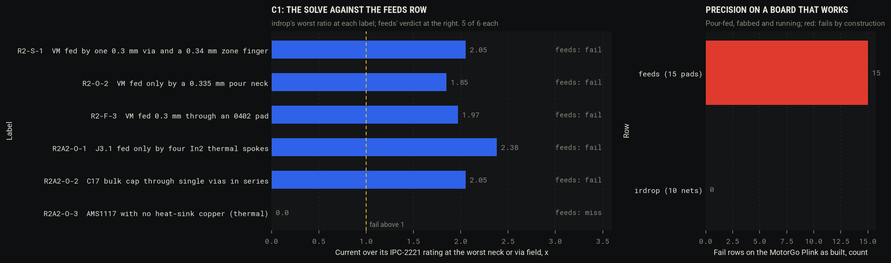
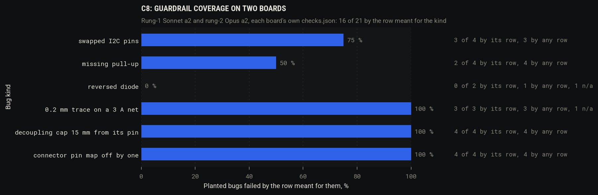

# Spike #3: fundamental versions of the human-workflow conventions (C1, C2, C8; C3 to C7 and C9 on paper)

2026-11-03, branch `spike/3-conventions` (from `main` at 46f9be9, `main` merged again at aed4bd8 when routing
sessions 4 and 5 landed). Issue: alexchunlin/alex-pcb-skills#3, with its literature review and corrections. Everything
here was run on copies under `/tmp/spike3/`; no archived board was edited. Results JSON: `tools/spikes/spike3/results/`.

Mid-spike change of brief: `main` gained the repo's own `pcb irdrop` (`pcbir.py`, `pcbir_solve.py`, FINDINGS IRDROP-1).
That is the prior art for C1, so deliverable A became "measure the in-repo solver on the bench, wrap kicad-irdrop only if
the in-repo one misses a label or disagrees beyond a stated margin". It did neither, so there is no `pcb q irdrop`
wrapper; kicad-irdrop is in the report as the cross-check.

## A. C1: DC current on the real copper, as a row

**Hypothesis (as corrected by the review).** C1 is a wrapper, not a solver. A solve of each declared feed on the copper,
judged per neck and per via barrel by cross-section (the `feeds` arithmetic, IPC-2221 at the config's rise), catches the
feed majors on the rung-2 boards with 0 false fails, and adds recall or precision over the `feeds` rows. There is no
per-cell density limit to test (correction 2), and the thermal label is out of reach of a DC solve.

**Method.**
1. Prior art, in order: the repo's `pcb irdrop` (a 0.1 mm raster of KiCad's own hit tests, barrels as conductances,
   scipy under `uv`; it reported worst cells and drops, no verdict), then firedanceio/kicad-irdrop b508349
   (`/tmp/pcb-ref/kicad-irdrop`, run through its own venv built on KiCad's Python 3.9 with scipy and shapely).
2. Added a judge to the in-repo solver (`pcbir_solve.judge`): from the 300 hottest cells per layer outside pads, a cut
   across the copper perpendicular to the local current; the current crossing it against IPC-2221 for the cut's width x
   thickness (k 0.048 outer, 0.024 inner); one neck per 2 mm. Via barrels in fields (vias within 1 mm summed, as
   `feeds` sums them), rated by IPC-2221 internal on pi x drill x 25 um. A neck at least 0.9x as wide as an adjacent pad
   and at most 1 mm long is that pad's own exit (status `pad`, reported, not failed). Sinks the source cannot reach are
   reported (`unreached`) instead of a NaN solve (the PLINK-0 +5V case).
3. The cross-check against kicad-irdrop found the in-repo solver's via was a point contact (barrel tied to one 0.1 mm
   cell): drops through vias read 6 to 21 % high. Fixed as kicad-irdrop does it, ring cells tied to the barrel node.
4. `pcbcheck` row kind `irdrop` (opt-in block `{"sources": {NET: "REF.PAD,..."}, "grid_mm": 0.1}`): every net with
   `feeds` rows, each feeds pad solved alone at its own amps (the rows are per-pin worst cases; their sum, 5.3 A on rung 2
   VIN, is not a load), a capacitor's ripple amps solved alone and rated as rms heating, plus one solve at the net's
   `currents` total over its DC pads. The source comes from `irdrop.sources` or the part the `rails` block names first.
5. Bench: `tools/spikes/spike3/irdrop_bench.py` runs `pcb check --only feeds` and `--only irdrop` on the 10 replay
   boards; the five feed labels got `irdrop` locators naming the place the reviewer named
   (`tools/spikes/spike3/label_irdrop.py`). Precision on a working board: the published MotorGo Plink
   (`motorgo-plink-hardware` 0250d75, fabbed and running) with `tools/bench/plink/checks.json`.

**Results.**

| Label | Board | What the reviewer found | `feeds` | `irdrop` (worst place, ratio over IPC) |
|---|---|---|---|---|
| R2-S-1 | rung-2 Sonnet a1 | VM by one 0.3 mm via + 0.34 mm finger | fail, 1.22 A of 2.5 | via field of 1 at 2.5 A, x2.05; 0.3 mm neck x1.84 |
| R2-O-2 | rung-2 Opus a1 | VM by a 0.335 mm pour neck | fail, 0.00 A (pour not sized) | 0.3 mm x 3.4 mm neck at 2.5 A, x1.85 |
| R2-F-3 | rung-2 Fable a1 | VM 0.3 mm through an 0402 pad | fail, 1.36 A | 0.3 mm x 1.6 mm neck at 2.67 A, x1.97 |
| R2A2-O-1 | rung-2 Opus a2 | J3.1 on four In2 spokes | fail, 0.00 A (pour not sized) | one 0.3 mm In2 spoke at 0.98 A, x2.38 |
| R2A2-O-2 | rung-2 Opus a2 | C17 through single vias in series | fail, 0.00 A | two single vias at 2.5 A, x2.05 |
| R2A2-O-3 | rung-2 Opus a2 | LDO with no heat-sink copper | miss | miss (thermal; item B) |

- Recall: 5 of 6 for each row; `irdrop` adds no recall on the bench. Both rows depend on the same sink declarations: with
  the a2 designer's own 7 `feeds` rows (J3.1 and C17.1 were added at archive time), both rows fail 0 times on a2, and the
  a1 designers wrote no `feeds` rows at all. In the designer scope, neither row catches any of the five.
- Unlabelled fails: 1 place per row family on the bench, triaged true and added as a known true positive: L1.2's 3 A of
  5V reaches In2 through two single 0.3 mm vias (1.52 + 1.48 A against 1.22 A each); the reviewer's L1.2 `feeds` row
  passed on the 1.4 mm track touching the pad, which is not where the J3 current goes.
- Replay gate (`python3 -I tools/bench/replay.py`): ALL designer recall 14 fail / 17 fail-or-warn, **0 false fails**;
  rows scope 24 / 27, 0 false fails after the R2-O-2 locator was widened to the neck's whole length.
- Precision on the Plink as built: `feeds` fails 15 of 15 pads (every rail is a pour, which the row does not size);
  `irdrop` passes 10 of 10 nets, worst neck x0.9, one pad exit (J11.1 x1.11) reported.
- Pad exits not failed: rung-2 a2 U2.11 and U2.10 at x1.5 (the pour neck is the pin's own 0.4 mm width, three vias
  behind it; the reviewer did not raise them).



Cross-check, single-sink rails, same plating (25 um), `tools/spikes/spike3/crosscheck_irdrop.py`:

| Rail | in-repo 0.1 mm | in-repo 0.05 mm | kicad-irdrop 0.05 mm | drop diff 0.1 / 0.05 | busiest barrel, in-repo / kicad-irdrop |
|---|---|---|---|---|---|
| a2 VIN Q1 -> U2.11 2.5 A | 7.77 mV, 4.0 s | 7.41 mV, 11.9 s | 8.09 mV, 35.0 s | -4.0 / -8.4 % | 1.12 / 1.09 A |
| a2 5V L1 -> J3.1 3 A | 6.57 mV, 3.7 s | 6.39 mV, 8.3 s | 7.59 mV, 20.3 s | -13.4 / -15.8 % | 1.54 / 1.54 A |
| a2 MOTOR_A J1 -> U2.8 2.5 A | 16.48 mV, 1.1 s | 16.19 mV, 1.9 s | 16.33 mV, 1.1 s | +0.9 / -0.8 % | no vias |
| a1 Opus VIN -> U2.11 | 28.81 mV, 4.9 s | 24.51 mV, 20.0 s | 24.60 mV, 68.2 s | +17.1 / -0.4 % | 0.44 / 0.40 A |
| a1 Sonnet VIN -> U2.11 | 10.12 mV, 4.2 s | 9.26 mV, 12.1 s | 10.07 mV, 28.8 s | +0.5 / -8.1 % | 2.50 / 2.50 A |
| a1 Fable VIN -> U1.11 | 24.93 mV, 5.0 s | 23.38 mV, 12.8 s | 24.68 mV, 39.6 s | +1.0 / -5.3 % | 1.46 / 1.44 A |

The 5V gap is configuration: the in-repo solver takes `copper_oz` (inner 17.5 um), kicad-irdrop the file's stackup
(15.2 um); with the stackup's inner copper the in-repo 5V drop is 7.16 mV (-5.7 %) and VIN 7.80 mV (-3.6 %). The 0.1 mm
grid reads the 0.335 mm neck as 0.3 mm (x1.85 against x1.65 at 0.05 mm). Stated margin for a judge: every fail sits at
x1.25 or more, so a 17 % drop error or an 11 % barrel-current error flips no verdict; the verdict quantity (barrel and
neck current) agrees within 0 to 11 %.

Solve time: `pcb irdrop` 1 to 5 s a rail at 0.1 mm, 2 to 20 s at 0.05 mm; the `irdrop` row 2.4 to 11.7 s a rung-2 board
(4 to 9 solves), 0.6 to 1.3 s on a board without the block. The review's "5 to 30 s per rail at 0.05 mm" holds for
kicad-irdrop (1 to 68 s).

**Verdict: keep, as a precision fix, not a recall fix.** `irdrop` matches `feeds` on recall (5 of 6) with 0 false fails,
replaces "0.00 A, a pour also reaches the pad, its neck is NOT sized" with a measured neck and ratio, and passes the
pour-fed Plink where `feeds` fails 15 of 15 by construction. The recall gap is upstream of both rows: nothing declares
the sinks a designer forgot (C3).

## B. Thermal, bounded (one hour, unscored)

**Hypothesis.** An open 2-D thermal solver runs headless on the rung-2 attempt-2 board and gives a number for the LDO
and the DRV8874 pad. No open solver claims measurement validation (review), so nothing is scored.

**Method.** ShrinathN/kicad-analysis-suite bb52bef (GPL-3, own `.kicad_pcb` parser), cloned to
`/tmp/pcb-ref/kicad-analysis-suite` and used as a library by explicit path (`tools/spikes/spike3/thermal_kas.py`,
never vendored). Heat from the designer's own calcs rows: U3 as the suite's LDO model (5.0 V in, 3.3 V, 0.5 A: 0.875 W);
U2 as its linear model VM to OUT1 at 2 A with a 0.72 V drop (1.43 W, `p_drv_2a`), so the 2 A runs through the real VIN
and MOTOR_A copper and the loss lands on the pads by area (exposed pad 93 %). A plain resistor element, tried first,
heats its two pads equally and put 113 degC on the 0.4 mm VM pin. Ambient 40 degC, h from temperature (15.2 W/m2K mean).
`kisi` was not tried (time box).

**Results.**

| Case | U3 AMS1117 board at its pads | U2 DRV8874 board at its pads | Hottest point | Solve |
|---|---|---|---|---|
| LDO alone, 0.875 W | 77.2 degC | | 77.4 degC at the tab | 21.8 s |
| Driver alone, 1.43 W | | 86.6 degC | 86.6 degC at the exposed pad | 19.5 s |
| Both | 93.9 degC | 96.2 degC | 96.2 degC | 26.3 s |
| Designer's claim (theta_ja) | Tj 116.5 degC (90 K/W) | Tj 91.8 degC (36 K/W) | | |

These are board temperatures under the parts, not junctions (no psi_jb in the BOM). The two parts heat each other by
17 and 10 K, which neither theta claim includes.

**Verdict: runs and gives a number; keep as an `info` row candidate, not a check.** A `temp` row waits for C2's
thermocouple readings on U3 and the DRV8874 pad (bring-up steps 6 and 7).

## C. C2 preparation (nothing ordered)

**Hypothesis (corrected).** The hardware loop is ready to order when (1) the extended-part fee, the largest quote line, is
counted by a row with its basic alternatives, (2) a fixture plate comes from `pcb q` coordinates, (3) BRINGUP.md runs as
a test with logged readings, and (4) an order checklist exists.

**Method and results.**

1. `basic_parts` row (opt-in) and `tools/bench/jlc_parts.py`: every LCSC code on the boards fetched from JLC's parts
   endpoint into `tools/bench/data/jlc_parts.json` (2026-11-03, 32 codes); alternatives searched with the endpoint's
   basic-library filter. Extended types warn with the fee and any basic alternative; stock below quantity x boards fails.

   | Board | LCSC lines | Extended types | Feeder fee | Thinnest stock |
   |---|---|---|---|---|
   | rung-2 Opus a2 | 29 | 17 | $52.19 | AO4407A 1,154 |
   | rung-1 Sonnet a2 | 5 | 2 | $6.14 | LSM6DS3TR-C 19,514 |

   Extended 0402 passives on rung 2 and their basic options:

   | Ref | Part | Role (calcs row) | Basic option | Effect |
   |---|---|---|---|---|
   | C13 | 22 nF 0402, C337699 | charge-pump flying cap | C1532, 22 nF 0402 | drop-in |
   | C8 | 33 nF 0402, C7419416 | buck compensation | C21117 / C1739, 0603 / 0805 only | footprint change |
   | R10 | 2.74 k 0402, C33360 | IPROPI sense | C13167 2.7 k 0603 | footprint change; v_sense_2a 2.457 V, i_trip 2.69 A, both in limits |
   | R4 | 68.1 k 0402, C11537 | buck RT | C23231 68 k 0603 | footprint change; fsw 699.6 kHz, in limits |
   | R1 | 52.3 k 0402, C26982 | buck feedback top | none at 52.3 k; 51 k (C25794 0402) | vout 4.88 V fails the 4.9 V row: not an option |

   One drop-in saves $3.07; with three 0603 footprints, $12.28. The review's "five 0402 passives with basic alternatives,
   about $35" is one drop-in and three footprint changes.
2. Pogo-pin plate: `tools/spikes/spike3/jig/jig_points.py` takes the test pads and the DNP header's plated holes from
   `pcb q` on the rung-1 Sonnet a2 board (TP1 3V3, TP2 GND, J3.1-4 INT1/INT2/SDA/SCL) and the two M2.5 holes into a
   board-centred frame; `build_jig.py` builds the plate with alex-3d-skills cadlib (`cad build`): 33.5 x 33.5 x 6 mm, six
   1.1 mm P75 holes with 1.6 mm collar seats, two 2.9 mm holes over H1/H2. Build 0.9 s, `cad printcheck` PASS (no
   support), holes probed with `cad q inside`. STL: `tools/spikes/spike3/results/jig/pogo_plate.stl`. The plate is held
   over the face-up board on M2.5 standoffs. openfixture (laser DXF) was not needed.
3. Bring-up on OpenHTF 1.6.3: `tools/spikes/spike3/bringup/bringup_htf.py` parses BRINGUP.md into (step, measurement,
   limits) rows (`= 3.3 V +/-0.1 V`, `+/- 2 %`, `> 10 kOhm`, `below 1 ohm`, `10-40 mA`, `within +/-100 mg`,
   `expected **0x6A**`, a failure sentence inverted: "a short reads below 10 ohm" becomes min 10 ohm) and runs one phase
   per step against `SimInstrument`. Rung 1: 17 measurements in 6 steps, 2 operator-only steps, PASS; with WHO_AM_I
   0x69 and TP1 3.05 V injected, FAIL on exactly those two. Rung 2: 19 measurements in 7 steps, 4 operator-only steps
   (driver enable, fault, encoder, visual), PASS. Records in `tools/spikes/spike3/results/bringup/`. Not parsed: "1.245 V
   per A" (a slope), "about 1.4 A".
4. `docs/spikes/ORDER.md`: both fab packages regenerated with `pcb fab` and checked (14 gerber/drill files each, BOM
   0 lines without LCSC, CPL offsets listed), stock, quote inputs, an Economic PCBA estimate (2 / 5 / 50 boards: rung 1
   $19.77 / $25.65 / $113.89, rung 2 $78.42 / $97.82 / $388.89, bare boards and shipping not included) and the checklist.
   Correction: the rung-1 board is 4 layers, not 2.

**Verdict: keep all four; the order is Alex's.** `basic_parts` measures the $52 line on every board; the jig and the
bring-up script are skeletons that ran end to end without hardware.

## D. C8: planted bugs against each board's own checks.json

**Hypothesis.** Planting the six GAMEPLAN section-4 bug kinds into copies of two archived boards measures what fraction
the design's own `checks.json` catches through `pcb check`: the guardrail coverage.

**Method.** `tools/spikes/spike3/mutate.py` plants one bug into a copy of the board and its netlist, so both carry it as a
regenerated design would (pad nets and netlist nodes swap together; a part goes from both; a connector's nets rotate by
one; the longest segment of a net is redrawn at 0.2 mm; a cap moves 15 mm from its pin on the board).
`mutation_bench.py` runs `pcb check` with the archived config on each mutant and on an unmutated copy (same load and
save) and counts new fail rows. A catch counts for the kind only if the failing row's family is the one meant for it
(connectors/pinmaps for swaps, pullups for pull-ups, currents/feeds/irdrop for the trace, decoupling for the cap);
a catch by another family is `incidental`. Instances picked by hand, the parts a reviewer would name; a kind the board
has no circuit for is n/a.

**Results.** 21 mutants, 19 fail some row, **16 fail the row meant for the kind (76 %)**:

| Bug kind | Rung-1 Sonnet a2 | Rung-2 Opus a2 | By its row | By any row |
|---|---|---|---|---|
| Swapped I2C pins | U1 SDA/SCL: **missed**; J1 3/4: connectors | no I2C; U2 PWM/DIR: pinmaps; J2 ENC A/B: connectors | 3 / 4 | 3 / 4 |
| Missing pull-up | R1, R2: pullups | R12 nFAULT, R5 ENC_A: only a calcs row that names the part | 2 / 4 | 4 / 4 |
| Reversed diode | n/a (no diode) | D4 TVS: only `irdrop` (the swap leaves VIN copper on a GND pad); D3: **missed** | 0 / 2 | 1 / 2 |
| 0.2 mm trace on a 3 A net | n/a (no net above 0.1 A) | 5V, VIN: currents; MOTOR_A: currents, feeds, irdrop | 3 / 3 | 3 / 3 |
| Decoupling cap 15 mm away | C1, C2: decoupling | C10 (VM), C1 (PVIN): decoupling | 4 / 4 | 4 / 4 |
| Connector map off by one | J1, J2: connectors | J3, J2: connectors | 4 / 4 | 4 / 4 |



The misses name the missing rows: the rung-1 config declares no `pinmaps` for U1, so the IMU-side SDA/SCL swap (the
Plink v1 bug) passes; rung 2 declares no `buses`, so a missing pull-up is seen only because a calcs row reads R12/R5; no
row knows a diode's orientation. Caveat: a board mutant swaps pad nets without re-routing, so copper left on the old net
can trip a connectivity row (the D4 catch); the family rule keeps those out of the 16.

**Verdict: keep; 76 % is the number to raise.** Cheapest fixes: the project template asks for `pinmaps` on every IC bus
and power pin, a `buses` block wherever a pull-up exists, and a diode-orientation row (declared anode/cathode nets,
the `pinmaps` code with a different key). The mutation bench is ready to re-run after each (1.5 min).

## E. C3 to C7, C9: feasibility after the review (no code)

- **C3, copper from current.** Half exists: `pcb route classes` writes IPC widths from `currents` (session 5), and the
  `irdrop` row now verifies what the copper does with the current. The measured gap is the sinks: on a2 with the
  designer's own feeds rows neither row fails, because no row names J3.1 or C17.1 as a place current goes. The next step
  is generating sinks: every connector pin and power-input pin on a `currents` net solved at the net current (a 30-line
  change to the `irdrop` row; on a2 it would put J3.1 under 4 A and fail its spokes). Feasible, half a session, next
  after this spike.
- **C4, margin as an objective.** The rows already carry `value` and `limit`, and `irdrop` adds IPC ratios per neck, so
  a per-board margin score is an aggregation. `pcbsig.plan_cost` already ranks routed plans by a weighted sum with a
  sensitivity check. Correlating a margin score with 10 reviewer scores will not separate signal from reviewer noise;
  feasible in half a session, low value until there are more reviews or C2 data.
- **C5, search and panel.** The search is cheap and exists (`pcb route waves --search`, 170 to 235 s a board). The panel
  claim needs one JLC quote form, which ORDER.md step 7 records; the review's correction stands (under 1.3x only for
  assembled orders). Minutes, at order time.
- **C6, verified parts corpus.** The R2-O-1 blocker class (a 2x10 part on a 2x5 footprint) needs no LLM: the JLC cache
  now stores the package string per LCSC code (`XDFH-0254-2*5P` on a2's J3), so a sourcing-attributes row comparing the
  package's pin count with the footprint's pads is about 40 lines on `tools/bench/jlc_parts.py`. Not done here (over the
  30-minute limit with its bench labels); the cheapest next row.
- **C7, simulated calcs.** KiCad 10's `kicad-cli` has no `sim`; the route is a SPICE netlist export plus `ngspice -b`.
  The cost is models: TI's DRV8874 and TPS54620 models are vendor PSpice, not in the Zener parts, so the buck and
  IPROPI cases need a model import per part. The I2C rise time is an RC the `calcs` rows already express. Drop for now;
  revisit if C2 measures a waveform claim wrong (buck ripple is the candidate).
- **C9, firmware-derived pin map.** The `pinmaps` and `connectors` rows already compare a declared pin-to-net map with
  the netlist; what is missing is generating that block from the firmware header. C8 shows why it pays: the one missed
  swap is a missing `pinmaps` row. A header parser for the Plink firmware's `#define` pins into a `pinmaps` block is
  about 50 lines; feasible in half a session.

## Why not the existing code

- **C1.** The prior art was the repo's own `pcb irdrop`, measured first: it found R2A2-O-1 as the hottest cell (IRDROP-1)
  but had no verdict, so on its own it catches 0 labels as fails. kicad-irdrop was run on six rails: it agrees with the
  in-repo solver within 0 to 11 % on the barrel currents a verdict uses and within 6 % on drop on the two rails re-run with matched copper,
  takes up to 14 times longer (median 7x), and has no verdict on plane cells either (barrels rated at a fixed 10 degC, load split equally
  over a part's pads, one rail per net). So the change is the smallest one: a judge function and a ring-tie fix in the
  existing solver (found by the cross-check), and a row that reads `feeds`. No new solver, no wrapper.
- **B.** kicad-analysis-suite used as is, from its clone (GPL-3, so not vendored); no code of ours beyond the 60-line
  driver.
- **C2.** `basic_parts` reuses JLC's own endpoint (the review's) and `pcbq.field`; the jig uses alex-3d-skills cadlib, not
  new CAD code (openfixture's DXF route was the fallback, not needed); the bring-up script is OpenHTF's phases and
  validators, not a test runner of ours.
- **C8.** `tools/bench/replay.py` stays the harness for labels; the mutant generator is the missing piece the review named
  (StaAgent, muSE), 170 lines on pcbnew and ElementTree.

## What to merge

- `skills/kicad-design/scripts/pcbir.py`, `pcbir_solve.py`: `judge()` (necks, via fields, unreached sinks), ring-tied
  vias, `run()` for callers; selftest extended (a 0.3 mm x 3 mm neck at 2 A is x1.48, a fail).
- `skills/kicad-design/scripts/pcbcheck.py`: `irdrop` and `basic_parts` row kinds (both opt-in).
- `examples/rung2-zener-a*/checks.json`, `tools/bench/plink/checks.json`: the `irdrop` blocks (sources only).
- `tools/bench/labels.json`: `irdrop` locators on R2-S-1, R2-O-2, R2-F-3, R2A2-O-1, R2A2-O-2 and one known true positive
  (a2 L1.2 vias); `tools/bench/results/replay.jsonl` rows.
- `tools/bench/jlc_parts.py`, `tools/bench/data/jlc_parts.json`.
- `tools/verify_all.sh`: section 30 (judge selftest, the a2 row, Plink precision, `basic_parts` on the cache); section 26's
  fail lists scoped to the non-`irdrop` rows and section 28's 5V drop 9 -> 7 mV (the ring ties); the missing `#@ end 29`
  marker (the selector refused to plan without it; section 29 moved ahead of the plumbing tail); `tools/bench/plink_signals.py`
  and `tools/readme/**` added to `#@ none` (unwatched since the dev merge, the selector's own check failed on them).
- `tools/spikes/spike3/**`, `docs/spikes/`, `docs/img/spikes/`: evidence, not tools; merge for the record.
- Not for merge as tools: nothing installed under `/tmp/pcb-ref/` is referenced by a row; kicad-irdrop is used only by
  `crosscheck_irdrop.py`, kicad-analysis-suite only by `thermal_kas.py`.

Install, if the cross-checks are re-run:

```sh
git clone https://github.com/firedanceio/kicad-irdrop /tmp/pcb-ref/kicad-irdrop
/Applications/KiCad/KiCad.app/Contents/Frameworks/Python.framework/Versions/Current/bin/python3 -m venv --system-site-packages /tmp/pcb-ref/kicad-irdrop/.venv
PYTHONNOUSERSITE=1 /tmp/pcb-ref/kicad-irdrop/.venv/bin/python3 -m pip install --ignore-installed numpy==2.0.2 "scipy<1.14" "shapely>=2.0,<2.1"
git clone https://github.com/ShrinathN/kicad-analysis-suite /tmp/pcb-ref/kicad-analysis-suite
```
