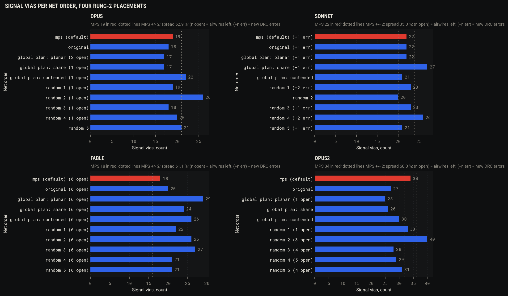
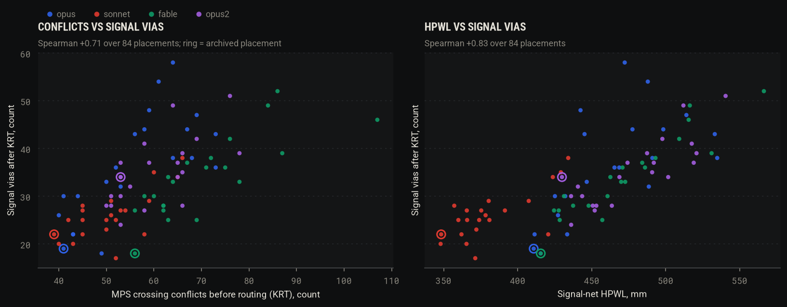

# Spike 4: routing as topology before geometry (2026-11-03)

Issue: [#4](https://github.com/alexchunlin/alex-pcb-skills/issues/4). Branch `spike/4-topology`. Router: KiCadRoutingTools
0.23.7 at `/tmp/pcb-ref/KiCadRoutingTools` (the bench's install, unchanged), every call with `PYTHONHASHSEED=0`
(ROUTE-T3). Boards: the four archived rung-2 placements, `examples/rung2-zener-a1-{opus,sonnet,fable}` and
`examples/rung2-zener-a2-opus` (opus2 below). Tables are regenerated by `tools/spikes/spike4/report.py` from
`tools/bench/results/{route,plan,placements}.jsonl`.

## Hypotheses, as corrected by the literature review

- **H1.** KRT's own MPS conflict count (crossings between the nets' MST segments, computed from the placement before
  routing) predicts KRT's signal vias better than HPWL, by Spearman over the four boards and a perturbation set. A
  room-based forced-crossing count for connector rows is added if it fits in an hour. Null: HPWL does as well or better.
- **H2.** Net order matters little: the default `--ordering mps`, `--ordering original`, KRT's global-plan orders
  (`KICAD_GLOBAL_PLAN=1` with `KICAD_GLOBAL_PLAN_ORDER=planar|share|contended`; in 0.23.7 the order is a second knob,
  not the value of the first) and 5 seeded random orders all land within 2 signal vias of MPS on every board. If so,
  roadmap item 6 (ordering search) closes with no new code. Null: some board shows a wider spread.
- **H3**, run only if H2 shows a spread of 10 % or more on some board: agent-written `--guide-corridor` polylines for VIN,
  5V and the motor nets on the opus2 placement beat KRT alone on vias and length without making the `feeds` rows worse.

## Method

1. **`signal_vias`** (deliverable A). `pcb route measure` and every route-bench and plan-bench row now carry
   `signal_vias`: vias on nets that have no filled zone on an inner layer (`pcbroute.plane_nets`), with the per-net
   split. `vias` also counts plane stitching, which the P6-T4 stitch pass adds and the designers placed by hand. On the
   archived boards as handed in: opus 71 vias / 11 signal, sonnet 75 / 20, fable 53 / 14, opus2 64 / 27.
2. **H2 on the route bench.** `route_bench.py --variants tracks --routers krt --tag spike4-h2`: each board copied,
   footprints sorted (`pcb route canon`), tracks and vias stripped, pours kept, one KRT pass on the shipped config
   (`outer`: setup kept, sizes exact, inner layers obstacle-only, ROUTE-T1). New configs: `outer_original`,
   `outer_gp_{planar,share,contended}` (env tokens) and `outer_rand1..5`: KRT's own routed-net list (`pcbkrt.py nets`,
   KRT's `expand_net_patterns`, `resolve_net_ids`, `filter_already_routed`, `filter_routable_nets`) shuffled with seed
   N and passed as `--nets` under `--ordering original`. Every row records KRT's printed routing order; the random
   arms route in exactly the order passed (literal names keep their order in `expand_net_patterns`).
3. **H2 inside the waves** (the coordinator's change, since `plan_bench.py` compares plans on three of the four boards
   with the judges Alex ranks by): `plan_bench.py orders` turns the rules plan into the same arms (each wave's nets
   expanded by KRT and shuffled, or `--ordering original`; global plan via `score --env`), scored with the SIG judges on
   Alex's stackup (In1/In2 ground, feeds and thermal vias). Run on opus and opus2; sonnet was dropped for time
   (50 min of router) after opus and opus2 gave the same answer.
4. **H1.** `pcb q BOARD conflicts`: a temp copy stripped and sorted as `pcb route auto` hands it to KRT, then KRT's
   `compute_mps_net_ordering(return_extended_info=True)` with route.py's defaults through `pcbkrt.py` (KRT's venv;
   KiCad's Python has no numpy). Output: nets, conflicts and the edge list, conflicts between signal nets, MPS rounds,
   bipartiteness, KRT's order, HPWL over all nets and over the signal nets. The count equals the line KRT prints when it
   routes the same board on all four (opus 31 nets / 41 conflicts, sonnet 30 / 39, fable 33 / 56, opus2 28 / 53;
   verify_all 30). Perturbations (`tools/spikes/spike4/perturb.py`): per board the archived placement plus 20 more,
   every footprint except connectors, mounting holes and locked parts moved by N(0, sigma) with sigma 1, 2, 3, 4 mm in
   turn, a draw rejected when its courtyard polygon or pad boxes overlap a neighbour more than in the input or leave
   the board, and the whole placement redrawn (up to 12 times) while KiCad's DRC on the stripped board shows more
   overlap-type errors than the archived one. Each routed once with the full `outer` config. `--quick 2` exists in KRT
   but left 11 airwires on the archived opus2 placement where the full pass leaves 0, so its via count is not a label.
   84 rows in `tools/bench/results/placements.jsonl` (tag `spike4-h1`) with the placement as (ref, x, y, rot), the
   conflict edges and the routed numbers, for spike #1.
5. **H3.** `pcb route waves` takes per-wave `guides` (gr_line chains on User.1, `--guide-corridor`), since KRT's
   waypoint list is one per run. On opus2's plan-bench base: the rules plan (KRT alone), the same plan with the power
   wave split into one wave per net (VIN, 5V, MOTOR_A, MOTOR_B, then VIN_RAW: the control), and the split plan with my
   corridors (`tools/spikes/spike4/h3_plans.py`), judged with the SIG judges and the archived board's `feeds` rows
   (`tools/spikes/spike4/feeds.py`).

## Results

### H2 on the route bench (one KRT pass, pours kept)

| board | arm | airwires | new DRC errors | vias | signal vias | length mm | KRT wall s |
|---|---|---|---|---|---|---|---|
| opus | mps (default) | 0 | 0 | 36 | 19 | 522 | 48.6 |
| opus | original | 0 | 0 | 37 | 18 | 471 | 56.5 |
| opus | global plan: planar | 2 | 0 | 34 | 17 | 429 | 64.0 |
| opus | global plan: share | 1 | 0 | 34 | 17 | 431 | 93.6 |
| opus | global plan: contended | 1 | 0 | 40 | 22 | 555 | 65.9 |
| opus | random 1 | 1 | 0 | 34 | 19 | 480 | 59.3 |
| opus | random 2 | 1 | 0 | 45 | 26 | 594 | 91.2 |
| opus | random 3 | 1 | 1 | 38 | 18 | 495 | 101.0 |
| opus | random 4 | 1 | 0 | 37 | 20 | 451 | 115.4 |
| opus | random 5 | 0 | 0 | 36 | 21 | 472 | 78.4 |
| sonnet | mps (default) | 0 | 1 | 38 | 22 | 412 | 24.5 |
| sonnet | original | 0 | 1 | 41 | 22 | 420 | 22.7 |
| sonnet | global plan: planar | 0 | 1 | 45 | 22 | 478 | 28.3 |
| sonnet | global plan: share | 0 | 1 | 51 | 27 | 515 | 31.0 |
| sonnet | global plan: contended | 0 | 0 | 35 | 21 | 434 | 20.5 |
| sonnet | random 1 | 0 | 2 | 49 | 23 | 546 | 44.9 |
| sonnet | random 2 | 0 | 0 | 41 | 20 | 545 | 46.6 |
| sonnet | random 3 | 0 | 1 | 46 | 23 | 497 | 44.6 |
| sonnet | random 4 | 0 | 2 | 50 | 26 | 483 | 28.7 |
| sonnet | random 5 | 0 | 1 | 36 | 21 | 418 | 21.9 |
| fable | mps (default) | 6 | 0 | 52 | 18 | 592 | 121.5 |
| fable | original | 6 | 0 | 57 | 20 | 520 | 205.5 |
| fable | global plan: planar | 6 | 0 | 63 | 29 | 500 | 127.4 |
| fable | global plan: share | 6 | 0 | 59 | 24 | 497 | 134.0 |
| fable | global plan: contended | 6 | 0 | 64 | 26 | 510 | 102.4 |
| fable | random 1 | 6 | 0 | 58 | 22 | 560 | 107.5 |
| fable | random 2 | 6 | 0 | 70 | 26 | 527 | 169.4 |
| fable | random 3 | 6 | 0 | 63 | 27 | 508 | 151.5 |
| fable | random 4 | 6 | 0 | 54 | 21 | 520 | 244.3 |
| fable | random 5 | 6 | 0 | 55 | 21 | 506 | 177.0 |
| opus2 | mps (default) | 0 | 0 | 46 | 34 | 655 | 22.4 |
| opus2 | original | 0 | 0 | 43 | 27 | 598 | 33.9 |
| opus2 | global plan: planar | 1 | 1 | 38 | 25 | 594 | 26.5 |
| opus2 | global plan: share | 0 | 0 | 40 | 26 | 589 | 27.2 |
| opus2 | global plan: contended | 0 | 0 | 47 | 30 | 500 | 38.8 |
| opus2 | random 1 | 1 | 0 | 49 | 33 | 546 | 40.5 |
| opus2 | random 2 | 3 | 0 | 51 | 40 | 630 | 53.4 |
| opus2 | random 3 | 4 | 0 | 39 | 28 | 540 | 17.5 |
| opus2 | random 4 | 5 | 0 | 43 | 29 | 543 | 25.4 |
| opus2 | random 5 | 4 | 0 | 43 | 31 | 519 | 25.5 |

New DRC errors are plain errors above the stripped input's own (sonnet's input carries 1 starved thermal; fable's 25
errors and 6 open GND/5V/3V3/nSLEEP pads are its unfinished placement, P6-T3). The MPS row reproduces the earlier
bench exactly (opus 36 vias, opus2 CLEAN 46 vias) and placement 0 of the H1 set reproduces it again.

| board | MPS signal vias | random orders | max abs(random - MPS) | all arms min-max | spread (max-min)/min | cheapest arm with 0 airwires and 0 new errors |
|---|---|---|---|---|---|---|
| opus | 19 | 19, 26, 18, 20, 21 | 7 | 17-26 | 53 % | original 18 (MPS 19) |
| sonnet | 22 | 23, 20, 23, 26, 21 | 4 | 20-27 | 35 % | random 2 20 (MPS has +1 error) |
| fable | 18 | 22, 26, 27, 21, 21 | 9 | 18-29 | 61 % | none (inherited) |
| opus2 | 34 | 33, 40, 28, 29, 31 | 6 | 25-40 | 60 % | global plan: share 26 (MPS 34) |

Completion, the other half: MPS leaves 0 airwires on all three finished boards; the random orders leave 1 to 5 on 9 of
15 runs (opus 4 of 5, opus2 5 of 5, sonnet 0 of 5 but 4 of 5 with a new error). A one-pass KRT run is chaotic in the
order: no arm is best on two boards, and MPS is the median or worse on signal vias on three of four.

### H2 inside the rules wave plan, with the judges (Alex's stackup)

| board | arm | clean | vias | signal vias | length mm | VIN mW | fast off mm | mid off mm | return-via bad | exposure mm | currents fails | wall s |
|---|---|---|---|---|---|---|---|---|---|---|---|---|
| opus | mps | yes | 45 | 32 | 557 | 259.4 | 0 | 0 | 9 | 4.3 | 4 | 284.1 |
| opus | original | yes | 49 | 37 | 551 | 259.4 | 0 | 0 | 8 | 4.3 | 4 | 282.6 |
| opus | gp_planar | yes | 49 | 36 | 548 | 259.4 | 0 | 0 | 12 | 6.1 | 4 | 182.0 |
| opus | gp_share | yes | 48 | 35 | 545 | 259.4 | 0 | 0 | 12 | 4.3 | 4 | 188.2 |
| opus | gp_contended | yes | 44 | 30 | 541 | 259.4 | 0 | 0 | 6 | 4.3 | 4 | 264.2 |
| opus | rand1 | yes | 47 | 34 | 557 | 259.4 | 0 | 0 | 9 | 4.3 | 4 | 259.8 |
| opus | rand2 | yes | 47 | 34 | 579 | 259.4 | 0 | 0 | 10 | 4.3 | 4 | 287.2 |
| opus | rand3 | yes | 49 | 36 | 536 | 259.4 | 0 | 0 | 10 | 4.3 | 4 | 452.0 |
| opus | rand4 | yes | 52 | 38 | 551 | 259.4 | 0.2 | 0 | 10 | 4.3 | 5 | 325.5 |
| opus | rand5 | yes | 50 | 37 | 552 | 259.4 | 0 | 0 | 10 | 4.3 | 4 | 185.0 |
| opus2 | mps | yes | 69 | 47 | 642 | 101.6 | 0 | 0 | 8 | 0.8 | 2 | 198.7 |
| opus2 | original | yes | 69 | 47 | 661 | 101.6 | 0 | 0 | 7 | 1.1 | 2 | 155.1 |
| opus2 | gp_planar | yes | 69 | 47 | 629 | 101.6 | 0 | 0 | 11 | 0.8 | 2 | 121.9 |
| opus2 | gp_share | no | 67 | 45 | 644 | 101.6 | 0 | 0 | 8 | 0.8 | 2 | 175.3 |
| opus2 | gp_contended | yes | 72 | 50 | 659 | 104.1 | 0 | 0 | 10 | 8.4 | 2 | 144.8 |
| opus2 | rand1 | yes | 65 | 41 | 621 | 101.1 | 0 | 0.5 | 6 | 12.6 | 2 | 134.2 |
| opus2 | rand2 | no | 67 | 43 | 580 | 101.1 | 0 | 0 | 5 | 12.0 | 2 | 150.1 |
| opus2 | rand3 | no | 76 | 53 | 714 | 102.9 | 0 | 0 | 12 | 14.4 | 2 | 154.9 |
| opus2 | rand4 | no | 71 | 50 | 607 | 101.1 | 0 | 5.8 | 13 | 5.8 | 2 | 223.0 |
| opus2 | rand5 | no | 66 | 44 | 615 | 102.1 | 0 | 0 | 6 | 12.0 | 2 | 220.4 |

Inside the waves the power wave (five nets) fixes VIN copper, so VIN loss moves by under 3 %. Signal vias spread
30 to 38 on opus (MPS 32, 27 %) and 41 to 53 on opus2 (MPS 47, 29 %); MPS is clean on both, 4 of 5 random orders are
not clean on opus2, and the opus2 orders that save vias pay in exposure (5.8 to 14.4 mm beside the switch node against
MPS's 0.8). The cheapest clean arm: opus `gp_contended` 30 signal vias (6 return-via fails against MPS's 9), opus2
`rand1` 41 (but exposure 12.6 mm, mid off ground 0.5 mm, so the SIG-4 cost ranks it below MPS).

### H1: conflicts and HPWL against signal vias (84 placements)

| set | n | Spearman conflicts vs signal vias (p) | signal conflicts vs signal vias (p) | HPWL vs signal vias (p) | signal HPWL vs signal vias (p) |
|---|---|---|---|---|---|
| all placements | 84 | +0.71 (0.000) | +0.60 (0.000) | +0.83 (0.000) | +0.83 (0.000) |
| clean routes only | 21 | +0.73 (0.000) | +0.61 (0.003) | +0.77 (0.000) | +0.79 (0.000) |
| opus only | 21 | +0.75 (0.001) | +0.74 (0.000) | +0.68 (0.002) | +0.70 (0.001) |
| sonnet only | 21 | +0.62 (0.004) | +0.45 (0.042) | +0.55 (0.012) | +0.63 (0.002) |
| fable only | 21 | +0.81 (0.000) | +0.75 (0.000) | +0.93 (0.000) | +0.95 (0.000) |
| opus2 only | 21 | +0.63 (0.003) | +0.48 (0.028) | +0.80 (0.000) | +0.79 (0.000) |
| within-board ranks, pooled | 84 | +0.71 (0.000) | +0.61 (0.000) | +0.74 (0.000) | +0.77 (0.000) |

- partial Spearman conflicts vs signal vias given hpwl_mm: +0.11 (Spearman conflicts vs hpwl_mm: +0.82, n 84)
- partial Spearman signal_conflicts vs signal vias given hpwl_signal_mm: -0.09 (Spearman signal_conflicts vs hpwl_signal_mm: +0.76, n 84)
- partial Spearman hpwl_mm vs signal vias given conflicts: +0.61 (Spearman hpwl_mm vs conflicts: +0.82, n 84)
- partial Spearman hpwl_signal_mm vs signal vias given signal_conflicts: +0.72 (Spearman hpwl_signal_mm vs signal_conflicts: +0.76, n 84)

| board | placements | clean | signal vias min / median / max | conflicts min-max | signal conflicts min-max | HPWL mm min-max |
|---|---|---|---|---|---|---|
| opus | 21 | 7 | 18 / 36 / 58 | 40-73 | 14-35 | 570-716 |
| sonnet | 21 | 5 | 17 / 25 / 38 | 39-66 | 13-30 | 553-648 |
| fable | 21 | 1 | 18 / 33 / 52 | 56-107 | 23-58 | 577-736 |
| opus2 | 21 | 8 | 24 / 34 / 51 | 50-78 | 37-57 | 575-687 |

| board | k | sigma mm | moved | conflicts | signal conflicts | HPWL mm | airwires | new errors | vias | signal vias | length mm |
|---|---|---|---|---|---|---|---|---|---|---|---|
| opus | 0 | 0.0 | 0 | 41 | 17 | 570 | 0 | 0 | 36 | 19 | 522 |
| sonnet | 0 | 0.0 | 0 | 39 | 13 | 553 | 0 | 1 | 38 | 22 | 412 |
| fable | 0 | 0.0 | 0 | 56 | 23 | 577 | 6 | 0 | 52 | 18 | 592 |
| opus2 | 0 | 0.0 | 0 | 53 | 40 | 575 | 0 | 0 | 46 | 34 | 655 |

Room-based forced crossings: the review's sound version counts interleaving only for nets whose every terminal sits on
a closed room's boundary (board edge plus connector rows). On all four boards no net has all its pads on connectors
(every connector net reaches an IC, a resistor or a cap inside the board), so the count is 0 by construction with the
board as the room. Smaller rooms bounded by impassable pad rings (the DRV8874 at 0.65 mm pitch) need the free space at
the design rules as polygons and a room finder; that is more than the hour the brief allows, and the result would have
to beat a conflict count that HPWL already dominates, so it was not built.

### H3: guide corridors on opus2

| arm | clean | vias | signal vias | length mm | VIN mW | VIN drop mV | VIN J A/mm2 | fast off mm | mid off mm | return-via bad | exposure mm | currents fails | wall s |
|---|---|---|---|---|---|---|---|---|---|---|---|---|---|
| rules plan (KRT alone) | yes | 69 | 47 | 642 | 101.6 | 21.2, 17.3 | 324 | 0 | 0 | 8 | 0.8 | 2 | 198.7 |
| split power wave, no guides | yes | 62 | 40 | 624 | 189.0 | 53.7, 19.5 | 374 | 0 | 0 | 8 | 0.8 | 2 | 206.8 |
| guided, two chains a net (VIN, 5V waves timed out at 300 s) | yes | 65 | 43 | 627 | 89.0 | 16.8, 16.8 | 519 | 0 | 0 | 7 | 0.8 | 3 | 735.9 |
| guided, one chain a net, 900 s (VIN timed out, 5V 793 s) | yes | 70 | 49 | 596 | 100.9 | 23.3, 15.2 | 519 | 0 | 0 | 10 | 0.1 | 3 | 1820.4 |

Feeds rows of the archived attempt-2 `checks.json` on the same copper: 3 of 9 fail on the rules plan and the split
(U2.10, U2.8, U1.4), 2 of 9 on both guided runs (U2.10, U2.8; U1.4 passes). The 'U2' motor pins fail in every arm, as in
FEED-2 (vias beyond the row's distance).

What happened in the guided runs: the 2-pin motor corridors routed in 6 to 11 s a wave, as unguided (11 and 15 s in
the split). The VIN corridor (17 pads, 1.4 mm class) never finished. In the one-chain run, whose log is complete, KRT
followed the waypoints, failed three MST edges on the west branch (C10.1, U2.11, C12.2: "terminal copper on F.Cu is
220.0um inside a foreign object's clearance and --escalation off forbids necking it"), then its per-net rescue ran
backward searches of 1 to 3 million iterations until the 900 s wave timeout; the two-chain run hit the 300 s timeout on
VIN and on 5V with no output kept (the driver now keeps it). In both, VIN was then routed unguided in the `rest` wave, so
the VIN numbers of the guided rows are not a corridor result. The one-chain 5V corridor routed, in 793 s against 50 s
unguided.

## Verdicts

- **H1: drop as a predictor that beats HPWL; keep the count as a secondary feature.** Spearman over 84 placements:
  MPS conflicts +0.71 against signal vias, HPWL +0.83 (signal-net HPWL +0.83); within-board ranks pooled +0.71 against
  +0.77. Conflicts carry almost nothing once HPWL is known (partial Spearman +0.11; HPWL given conflicts +0.61). The
  count wins within two boards (opus +0.75 vs +0.68, sonnet +0.62 vs +0.55) and loses on fable and opus2. It is not a
  lower bound either: it counts pairs, and KRT's signal vias fall below it on most placements (opus2: 53 conflicts, 34
  signal vias). For #1: the count is cheap (`pcb q conflicts`, a few seconds, most of it KRT parsing the board) and the 84 rows are labelled; HPWL is the
  baseline to beat, as #1's review already says.
- **H2: the null holds; roadmap item 6 stays open.** The random orders sit 4 to 9 signal vias from MPS (rule: 2), and
  the spread across arms is 35 to 61 % on the route bench and 27 to 29 % inside the waves. The default order is not the
  problem to fix, though: MPS is the most reliable at completion (0 airwires on every finished board where random
  orders leave 1 to 5), while the cheapest clean arm changes board to board (original, random 2, global plan share).
  What pays is the search item 6 describes: route a few orders (MPS, original, the three global-plan orders) and keep
  the best clean one by the SIG-4 rank. On the route bench that set saves 1, 1 and 8 signal vias on the three finished
  boards (opus2 34 to 26 with global plan share, -24 %); in the waves 2 on opus and 0 on opus2.
  `pcb route waves --search` already runs plans in
  parallel and ranks them, so the order arms are plan variants, not new code.
- **H3: drop.** The corridors did not beat KRT alone: signal vias 43 and 49 against 47, length 627 and 596 mm against
  642, the worst VIN current density 519 against 324 A/mm2, one more `currents` fail, and 4x to 9x the wall time
  (736 and 1820 s against 199). The one improvement, `feeds` U1.4 passing, comes with the VIN net routed in the
  `rest` wave rather than along a corridor. On multi-pin power nets KRT's waypoints break the MST edges they are
  assigned to and the rescue then searches for minutes; on 2-pin nets they cost nothing and change little. The
  split control shows the plan matters more than the sketch: VIN alone first is 189 mW against the power wave's 102.

## Why not the existing code

- **The conflict graph** is KRT's own: `pcbkrt.py` calls `compute_mps_net_ordering(return_extended_info=True)` with
  route.py's defaults and KRT's own net filters; no port. The only code is the 100-line shim (KRT needs numpy, which
  KiCad's Python lacks) and the HPWL/plane-net split in `pcb q`. Measured: the count equals KRT's printed count on all
  four boards (verify_all 30).
- **The ordering arms** are KRT flags and knobs: `--ordering mps|original`, `KICAD_GLOBAL_PLAN=1` with
  `KICAD_GLOBAL_PLAN_ORDER`, and `--nets` in a given order. The bench learned config tokens (`@ENV`, `@SHUFFLE`), the
  plan bench an `orders` command and `--env`. A planar-first order of my own (the original H2) was not written: MPS is
  that order already, and it does not win on vias.
- **Guide corridors** are KRT's `--guide-corridor` (User.1 polylines as A* waypoints, distributed over MST edges); the
  waves driver only had to place and remove the lines per wave, as it already does for keepouts. Topola and gEDA's
  toporouter were not run (review: neither creates a mid-route via; Topola ignores planes).
- **The perturbation generator**: spike #1's `place_gen.py` does not exist yet. KRT's `py_placer/placement/legality.py`
  has courtyard-rect legality but no seeded jitter driver and works on courtyard rectangles, which is the test that let
  C7 slide onto the DRV8874's pins here (the vendored courtyard leaves the pins outside), so the generator checks pad
  boxes too and uses KiCad's DRC as the final arbiter. `signal_vias` is a filter over the per-net via counts
  `pcb route measure` already had.

## Corrections found on the way

- `verify_all.sh` on main did not parse: section 29 sat after the closing plumbing block without its `#@ end 29`, so
  `verify_select.py` said "section 29 never ends" and `--changed` could not run. Sections 29 and 30 now sit before the
  plumbing block.
- In KRT 0.23.7 `KICAD_GLOBAL_PLAN` is an on/off gate and the order is `KICAD_GLOBAL_PLAN_ORDER`; the issue's
  `KICAD_GLOBAL_PLAN=planar` does nothing.
- `--quick 2` exists (the review thought not) but leaves connections open, so it is not a via label.
- KRT concatenates every User.1 polyline into one waypoint list per run.
- A timed-out wave lost KRT's output; `run_engine` now writes the partial stdout to the log.

## What to merge

- `skills/kicad-design/scripts/pcbroute.py`: `signal_vias`, `plane_nets`, per-wave `guides`, timeout output in the log.
- `skills/kicad-design/scripts/pcbq.py`: `pcb q conflicts`, `plane_nets`, `hpwl`.
- `skills/kicad-design/scripts/pcbkrt.py` (new): KRT's net list and MPS graph under KRT's venv.
- `tools/bench/route_bench.py`: `signal_vias` column, the ordering configs, `outer_quick2`, KRT order and MPS line per row.
- `tools/bench/plan_bench.py`: `signal_vias` in the judges, `orders`, `score --env`.
- `tools/verify_all.sh`: section 30, sections 29/30 moved before the plumbing block.
- `tools/spikes/spike4/` (new): `perturb.py`, `perturb_kpy.py`, `waves_arms.sh`, `h3_plans.py`, `feeds.py`, `report.py`.
- `tools/bench/results/route.jsonl` (spike4-h2 rows), `plan.jsonl` (spike4-h2-waves, spike4-h3), `placements.jsonl`
  (new; 84 spike4-h1 rows, plus 2 spike4-h1q rows from the abandoned `--quick 2` labels).
- `docs/spikes/spike-4-topology.md`, `docs/img/spikes/4-ordering.png`, `docs/img/spikes/4-conflicts-hpwl.png`.
