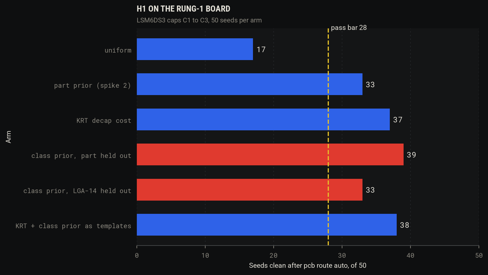
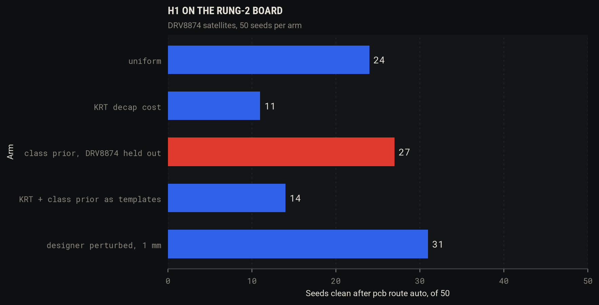
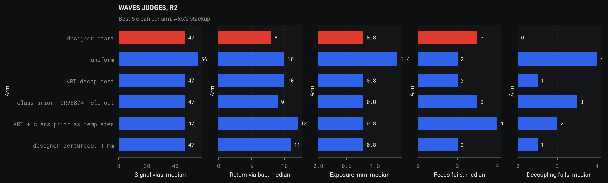
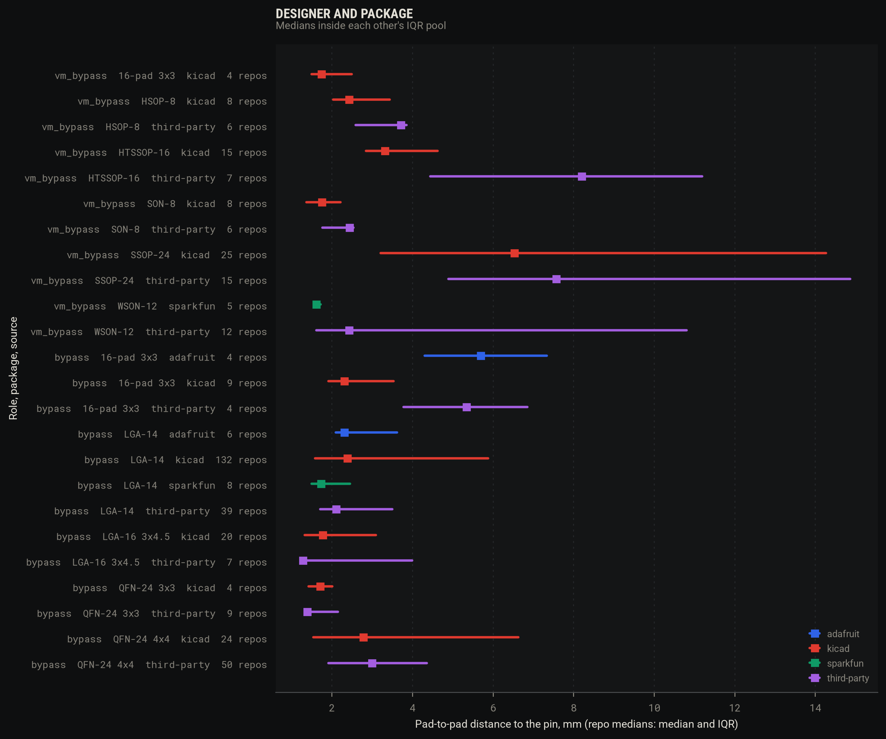

# Spike 5: placement priors pooled by component class

Issue: [#5](https://github.com/alexchunlin/alex-pcb-skills/issues/5). Branch `spike/5-class-priors` from `main` at 820621d.
This file was first committed with the Method section alone (5cbfb5a), before any scored route, so the design below is fixed
ahead of the results. Changes made after seeing results are listed under "Design changes after the Method commit".

## Method (fixed before the first scored route)

### Boards and moved satellites

- **r1**: `examples/rung1-zener-a2-sonnet`, `pcb route strip` (tracks and vias gone, zones kept). Moved: C1 and C2 (100 nF,
  `decoupling` rows on U1 pads 8 and 5), C3 (1 uF, pad 8). Everything else stays where the designer put it.
- **r2**: `examples/rung2-zener-a2-opus` (attempt 2), stripped the same way. Moved: C10 (VM 100 nF, bypass), C11 (VM 10 uF, bulk), R10
  (IPROPI to GND, current-mirror role). C12 (VCP to VM) and C13 (CPH-CPL flying cap) are charge-pump roles: each joins the
  moved set only if the pooled measurement, with DRV8874 held out, holds at least 5 rows from at least 3 repos in its role.
  That count is taken from the measured boards before the first r2 route and the set is then the same in every r2 arm. A
  satellite left out keeps the designer's pose in every arm.

### Arms and seeds

Seeds 0 to 49 per arm. Same arm list per board, every arm moves the same satellites and nothing else.

| Arm | r1 | r2 | Seeding |
|---|---|---|---|
| `uniform` | yes (comparator) | yes | spike 2's: x, y uniform over the outline box inset 1 mm, rotation from 0/90/180/270 |
| `part` | yes (comparator) | no | spike 2's LSM6DS3 prior, its own `priors-LSM6DS3.json` |
| `krt` | yes | yes | KRT `place_simple`, default weights (`--decap-weight 2`, no limit), one `--seed` per seed |
| `class_part` (r1) / `class` (r2) | yes | yes | class prior, test part held out |
| `class_pkg` | yes | no | class prior, all of LGA-14 held out |
| `krt_tpl` | yes | yes | KRT with one `templates[]` row per seed, the row drawn from `class_part` (r1) or `class` (r2), `--template-weight 100` |
| `perturb` | no | yes | the designer's satellite x, y plus N(0, 1.0 mm) per axis, rotation kept |

**r1 comparators.** `uniform` and `part` reuse spike 2's 17/50 and 33/50 only if 5 seeds per arm (0, 11, 22, 33, 44) of
`tools/spikes/spike2/placement-results.jsonl`, reseeded by the same code on today's `main`, give the same `moved` poses, the
same clean flag, and the same vias and length. Any mismatch reruns both arms for all 50 seeds.

**Perturbation sigma: 1.0 mm**, stated here before routing. Spike 1 saw no sigma trend on this board at 1 to 4 mm (7/38,
9/37, 12/37, 9/37), and 1 mm stays inside a tight satellite's working distance.

### Locking the KRT arms

KRT's own lock: `place_pose.py lock` on every footprint except the moved satellites, then `check_floorplan --emit-intent
--no-declare-decaps`, and one group {IC, moved satellites} anchored on the IC (`check_groups` passes on both boards).
`--decaps-from` is not used: it derives limits from the archived board, which is the designer's answer. Dry runs without
routing (12 seeds each, median pin distance per satellite) showed weight 10 and a 2 mm limit graded at error move the
median by at most 0.6 mm and add floorplan errors at weight 10 on r1 and with the limit on r2, so the arm runs at KRT's
defaults. 8 dry seeds on each board left no part illegal with the board locked.

### Illegal seeds

Every arm passes one gate, spike 2's: the moved part's courtyard box must not overlap another footprint's box (or a moved
part's) and must stay in the outline box.
- Sampled arms redraw a part up to 500 times; a part with no legal draw rejects the seed.
- KRT arms get one `place_simple` run per seed (its internal restarts included). The seed is rejected if `place_simple`
  exits non-zero, names a part illegal, or the result fails the gate.
- There are no replacement seeds. **A rejected seed counts as not clean in the /50 denominator**. Rejected seeds per arm
  are reported, and so is clean among the seeds emitted.

### Clean, and what is measured per seed

**Clean** is `pcb route auto`'s own verdict in `route.json`: 0 airwires, no new plain DRC error against the seeded input, packed
errors no higher, board setup unchanged. Per seed also: vias, signal vias (`pcb route measure`: vias on nets with no filled inner
zone), length, and `pcb check --only feeds,decoupling` on the routed board. KRT runs under `PYTHONHASHSEED=0`, at most 3
processes at once. The designer's own placement is routed once on each board as a reference row.

### Class prior

- **Class.** JLC category and `describe`, then KRT `_converters` on KiCad boards, then a reading pass on the misses. Pin-name
  rules are not used.
- **Instances.** KiCad corpus siblings from a new `scan.py --classes` pass, vendor Eagle (Adafruit, SparkFun), third-party
  Eagle. Modules are dropped by pad extent (a GY-521 is a header, not a package). Altium is out of role-keyed rows.
- **Package key.** Pad extent, pitch class and thermal pad by size, never the library name or the pad count.
- **Role.** From the pad's `pinfunction` and `pintype` on KiCad boards, from the `.sch` pin map on Eagle. Roles: supply bypass
  (under 1 uF to ground on a supply pin), bulk (1 uF and up), charge pump, shunt, current mirror, limit setting, pull-up,
  feedback.
- **Frame.** Rotation and mirror undone by `frame()`. Canonical orientation: long pad axis on x, pad 1 on the x < 0 side; for a
  square pad extent, pad 1 in the x < 0, y < 0 quadrant. Pad 1 is checked on LGA-14 and HTSSOP-16 from at least two sources
  before anything is pooled.
- **Pose.** The satellite's centre in the frame of the IC pin it serves (u out of the package at that pin, v a quarter turn from
  u) and the direction of its pin-side pad, so a sample carries across pinouts and package sizes. A cap sits next to a
  pin, not next to a package centre.
- **Pooling.** Three levels, part, package, class. Part weight n / (n + 30), or 1 at n >= 30. Of the rest, package weight
  n / (n + 30) the same way, and class takes what is left. A held-out level has n = 0. Within a level a draw takes a repo
  uniformly, then a row in that repo. Quantiles and medians shrink by the same weights (`tools/corpus/pooling.py`, tested).
- **Fallback.** A role with fewer than 5 rows in at least 3 repos at every level falls back to its family (`sense` for shunt,
  current mirror and limit setting), and the fallback is reported.
- Raw poses stay in `/tmp`. Published rows need n >= 5 and at least 3 repos.

### Order of work

The KRT arms on r1 run before any pooling code exists (issue step 1). If `krt` reaches 33/50 on r1 the class prior has to
beat it and the report says so plainly.

### Pass rules

Two-sided Fisher exact on clean counts /50; rank-sum (Wilcoxon, unpaired: seeds do not pair across arms) on signal vias of clean
routes; a comparison "beats" at p < 0.05 with the count in that direction.

**H1, r1.** For each of `class_part` and `class_pkg`, separately: clean >= 28/50, beats `uniform`, and does not lose to `krt`.
"Does not lose" means `krt` is not ahead by Fisher p < 0.05; if `krt` reaches 33/50 or more, the arm must beat `krt` outright.
Passing `class_part` and failing `class_pkg` reads as "the prior transfers within a package".

**H1, r2.** `class` beats `uniform` on clean, and among clean routes it has fewer failing `feeds` and `decoupling` rows than
`uniform` by rank-sum p < 0.05 on the sum of the two. It must not lose to `krt` or to `krt_tpl` as on r1. `perturb` is
reported beside it: a prior that only beats "anywhere on the board" says little.

**Waves judges, r2.** Each arm's best 5 clean placements (fewest signal vias, then shortest) and the designer's start go through
`pcb route waves` with the rules plan on Alex's stackup, and `plan_bench.judges`: refplane, return_via, exposure, irdrop,
`feeds`, `decoupling`. A class prior that wins on clean and loses on these is reported as a mixed result.

**Comparisons.** r1: `class_part` and `class_pkg` each against `uniform`, `part`, `krt`, `krt_tpl` (8), `krt` against `uniform` and
`part` (2), `krt_tpl` against `krt` (1). r2: `class` against `uniform`, `krt`, `krt_tpl`, `perturb` (4), `krt` against `uniform` (1),
`krt_tpl` against `krt` (1), `perturb` against `uniform` (1). 18 Fisher tests, and the same pairs on rank-sum where both arms
have at least 5 clean routes. Raw p values are reported with the Bonferroni line at 0.05 / 18 = 0.0028.

**H2.** Per (source org, package, role), repo as the unit of n: one repo median per repo, then the median and IQR of those.
Two rows pool when each median sits inside the other's IQR. Reported: whether designer or package moves the median more.

**H3.** Dropped under its own null. Counts only.

## Design changes after the Method commit

None of these followed a routing result on the arm it touches, except the last, which is post-hoc and marked as such.

- **Base commit.** The worktree came up at 1a224b4, not 820621d. The branch was re-pointed at `main` before any work.
- **Comparators rerun anyway.** The 5-seed check passed 10 of 10 (below), so 17 and 33 could be reused, but spike 2's rows hold no signal vias, and the rank-sum needs them. Both arms were rerouted for all 50 seeds and gave exactly 17 and 33.
- **Canonical frame.** The Method said long pad axis on x. Vendor boards showed that rule splitting near-square two-row packages (SSOP-24 landed two ways), and on HTSSOP-16 the pad-centre extent is row to row, not body length. The rule became: outward normal at pad 1 on -x. Changed before any class route. Back-side footprints also needed a mirror fix, since `GetFPRelativePosition` keeps the flip.
- **Board fetch cap.** `scan.py boards` ran on `imu6` and `hbridge` only, without L298 and L293, at 120 hits per part. MPU-6050 had 458 board-bearing hits. `ldo_fixed` and `buck_sync` are counted, not measured, so KRT `_converters` was never needed.
- **Class labels.** 103 of 116 parts labelled from JLC, 13 by reading (JLC files them under `New Arrivals` or `SMT`). 0 disagreed with the table. The model pass was not needed.
- **r2 moved set.** By the Method's rule, C12 (`cp_res`, 54 rows in 36 repos) and C13 (`cp_fly`, 7 rows in 7 repos) joined. All r2 arms moved C10, C11, R10, C12, C13. Your brief could also be read as keeping the flying cap at the designer's pose; I followed the issue's "no-prior unless the KiCad scan finds some".
- **Post-hoc, after r2.** 14 `class` seeds were rejected on C13. Three sensitivity runs followed, all outside the /50 tables, all in `route-results.jsonl`: tag `sens` and `sens2` (keep C13 at the designer's pose: 0 of 14 emitted, since the seed's own moved parts sat on that pose), `sens3` (same seeds, C13 drawn first), and `sens` on `krt_tpl` (template rows from ungated draws).

## Results

### Prior-art gate

KRT ran first, before `pooling.py` existed. **`krt` reached 37/50 on r1, above the part prior's 33, so under the rule the class prior had to beat KRT outright.** It did not.

The comparator check reproduced 10 of 10 rows: same poses, same clean flag, vias and length.

### Instances per class

All 939 shards in 674 s, 87,931 rows. Boards: 460 shards in 1,832 s, no throttling this time. Disk 2.8 GB.

| Class | Projects | Repos | With a board file | Board matched | Measured: KiCad / Adafruit / SparkFun / third-party Eagle |
|---|---:|---:|---:|---:|---|
| `imu6` | 995 | 664 | 998 | 539 | 324 / 12 / 11 / 160 |
| `hbridge` | 1,041 | 668 | 973 | 465 | 233 / 9 / 17 / 180 |
| `ldo_fixed` | 5,139 | 3,379 | 5,245 | 264 (spike 2's only) | not measured |
| `buck_sync` | 708 | 465 | 688 | 3 (spike 2's only) | not measured |

Measured means one instance per (repo, part, ref), modules and through-hole parts out by pad extent, role-keyed rows from the pad's pin function or the `.sch`. Parts (KiCad + Eagle): `tools/spikes/spike5/instances-summary.json`.

- `imu6`: MPU-6050 30+46, LSM6DS3 49+17, BMI088 37+7, ICM-42688 24+11, MPU-6000 13+21, BMI270 21+11, LSM6DSOX 9+20, BMI160 16+5, and 21 more.
- `hbridge`: TB6612 52+53, DRV8833 21+38, DRV8837 24+11, DRV8835 5+26, L9110 12+16, MC33926 2+20, A4950 10+7, TC78H660 15+0, DRV8874 13+1, DRV8871 1+12, and 22 more.
- Packages: `imu6` LGA-14 295, QFN-24 4x4 112, LGA-16 3x4.5 44, QFN-24 3x3 27, 16-pad 3x3 25. `hbridge` SSOP-24 107, HTSSOP-16 92, SON-8 50, HSOP-8 44, WSON-12 30.

Measurement funnel:

| Source | Jobs | Measured | Ref not on the board | Load failed | Net guard dropped | Measured, but no role row |
|---|---:|---:|---:|---:|---:|---:|
| Eagle (vendor + third-party) | 824 | 809 | 10 | 4 | 0 | 178 |
| KiCad corpus | 1,292 | 1,166 | 110 | 14 | | 429 |

Third-party Eagle: 1,125 `.brd` from 511 repos, 915 with a `.sch`; no `.sch` drops 216 instances. Module or through-hole drops: KiCad 411, third-party 217. Licence strings: 319 Eagle repos (no licence words 132, MIT 59, CC-BY-SA 38, none readable 31, GPL-3.0 18); KiCad repos by SPDX in the index (none 2,489 of 4,733, MIT 691, GPL-3.0 481).

### The frame

Pad 1 after the canonical turn, before anything pooled (`instances-summary.json`, `frame`):

| Package | Source | n | Pad 1 median, mm | Pad 1 top left | Needed a turn |
|---|---|---:|---|---:|---:|
| LGA-14 | KiCad | 209 | -1.16, -0.75 | 209 | 2 |
| LGA-14 | Adafruit | 6 | -1.16, -0.75 | 6 | 0 |
| LGA-14 | SparkFun | 9 | -1.16, -0.75 | 9 | 0 |
| LGA-14 | third-party | 68 | -1.16, -0.75 | 68 | 0 |
| HTSSOP-16 | KiCad | 54 | -2.86, -2.27 | 54 | 3 |
| HTSSOP-16 | Adafruit | 2 | -2.80, -2.27 | 2 | 2 |
| HTSSOP-16 | third-party | 36 | -2.82, -2.27 | 36 | 20 |

The review's quarter turn is real and the normalisation closes it: every instance lands with pad 1 at top left. Seeds use the pin frame on top of this, so the DRV8874 seeds land on the correct side by construction.

### H1, r1 (LSM6DS3)

| Arm | Rejected | Clean /50 | Clean of emitted | Signal vias of clean, median (range) | Vias, median | Length mm, median | `decoupling` fails, mean of 8 |
|---|---:|---:|---:|---|---:|---:|---:|
| `uniform` | 0 | 17 | 0.34 | 5 (2-8) | 18 | 175.6 | 4.76 |
| `part` | 0 | 33 | 0.66 | 8 (3-11) | 19 | 172.0 | 3.58 |
| `krt` | 0 | 37 | 0.74 | 6 (4-11) | 17 | 182.5 | 3.22 |
| `class_part` | 0 | 39 | 0.78 | 6 (3-11) | 19 | 175.1 | 2.51 |
| `class_pkg` | 0 | 33 | 0.66 | 6 (3-11) | 19 | 174.1 | 2.82 |
| `krt_tpl` | 0 | 38 | 0.76 | 6 (3-11) | 19.5 | 175.7 | 2.74 |

The designer's placement, routed once: clean, 19 vias, 7 signal vias, 183.9 mm. r1 has no `feeds` rows.

| Comparison | Clean | Fisher p | Signal vias, medians | Rank-sum p | `decoupling` rows, rank-sum p |
|---|---|---:|---|---:|---:|
| `class_part` vs `uniform` | 39 vs 17 | **0.00002** | 6, 5 | 0.099 | under 0.00001 |
| `class_part` vs `part` | 39 vs 33 | 0.265 | 6, 8 | 0.030 | 0.0016 |
| `class_part` vs `krt` | 39 vs 37 | 0.815 | 6, 6 | 0.929 | 0.019 |
| `class_part` vs `krt_tpl` | 39 vs 38 | 1.000 | 6, 6 | 0.938 | 0.493 |
| `class_pkg` vs `uniform` | 33 vs 17 | **0.0025** | 6, 5 | 0.017 | under 0.00001 |
| `class_pkg` vs `part` | 33 vs 33 | 1.000 | 6, 8 | 0.189 | 0.0059 |
| `class_pkg` vs `krt` | 33 vs 37 | 0.513 | 6, 6 | 0.183 | 0.133 |
| `class_pkg` vs `krt_tpl` | 33 vs 38 | 0.378 | 6, 6 | 0.318 | 0.733 |
| `krt` vs `uniform` | 37 vs 17 | **0.0001** | 6, 5 | 0.085 | under 0.00001 |
| `krt` vs `part` | 37 vs 33 | 0.513 | 6, 8 | 0.010 | 0.130 |
| `krt_tpl` vs `krt` | 38 vs 37 | 1.000 | 6, 6 | 0.876 | 0.107 |

Red marks the two class arms.

- The prior transfers. With LSM6DS3 out, LGA-14 siblings (299 bypass rows, 140 repos) gave 39/50. With all of LGA-14 out, other packages (234 rows, 130 repos, pin frame) gave 33/50, equal to the part prior.
- Nothing separates the four good arms on clean: 33 to 39, every pair p > 0.26.
- The class prior's edge over KRT is decoupling distance, not routability: 2.51 against 3.22 failing rows (p = 0.019). KRT leaves caps about 3 mm from the pin (dry runs: C1 2.96, C2 3.14, C3 3.16 mm). Its halo term around fine-pitch pads is the likely cause; I did not isolate it.
- `krt_tpl` seeds equal `class_part` seeds: at `--template-weight 100` KRT seats the drawn pose and nudges it for legality (0 to 0.1 mm on 4 dry seeds). Same draws, 38 against 39.

### H1, r2 (DRV8874)

| Arm | Rejected | Clean /50 | Clean of emitted | Signal vias of clean, median (range) | Vias, median | Length mm, median | `decoupling` fails, mean of 19 | `feeds` fails, mean of 9 |
|---|---:|---:|---:|---|---:|---:|---:|---:|
| `uniform` | 0 | 24 | 0.48 | 35 (29-45) | 54 | 676.7 | 3.83 | 6.12 |
| `krt` | 0 | 11 | 0.22 | 32 (26-37) | 46 | 578.1 | 1.27 | 5.64 |
| `class` | 14 | 27 | 0.75 | 29 (24-38) | 45 | 598.3 | 2.70 | 5.70 |
| `krt_tpl` | 15 | 14 | 0.40 | 31.5 (24-40) | 46.5 | 601.3 | 2.79 | 5.57 |
| `perturb` | 0 | 31 | 0.62 | 28 (22-35) | 45 | 600.5 | 1.19 | 6.26 |

The designer's placement, routed once: clean, 43 vias, 28 signal vias, 632.5 mm, `decoupling` 0 of 19, `feeds` 7 of 9 failing.

| Comparison | Clean | Fisher p | Signal vias, medians | Rank-sum p | Rows, rank-sum p |
|---|---|---:|---|---:|---:|
| `class` vs `uniform` | 27 vs 24 | 0.689 | 29, 35 | **0.00001** | 0.00008 |
| `class` vs `krt` | 27 vs 11 | **0.0018** | 29, 32 | 0.066 | 0.0024 |
| `class` vs `krt_tpl` | 27 vs 14 | 0.014 | 29, 31.5 | 0.239 | 0.735 |
| `class` vs `perturb` | 27 vs 31 | 0.544 | 29, 28 | 0.014 | 0.0027 |
| `krt` vs `uniform` | 11 vs 24 | 0.011 | 32, 35 | 0.051 | 0.00001 |
| `krt_tpl` vs `krt` | 14 vs 11 | 0.645 | 31.5, 32 | 0.700 | 0.020 |
| `perturb` vs `uniform` | 31 vs 24 | 0.228 | 28, 35 | under 0.00001 | under 0.00001 |

Red marks the class arm.

- **Rejected seeds decide the row.** All 14 `class` rejections are C13: 7 flying-cap rows at class level, and the seed's own earlier draws sit on them. `krt_tpl` inherits those 14 through its draw, plus 1 `place_simple` left C11 illegal. Among emitted seeds `class` is 27/36 against `uniform` 24/50, p = 0.015, but an arm is not judged on what it declined to emit, so 27/50 stands.
- **Post-hoc.** The 14 seeds with C13 drawn first: 8 clean, which would make 35/50, p = 0.041 against `uniform`, p = 0.53 against `perturb`. `krt_tpl` from ungated draws: 9 of 15 clean, which would make 23/50. These are not in the verdict. They say draw order on a thin pool cost the arm its seeds, and they would need a fresh pre-registered run to count.
- R10 drew from 6 `current_mirror` rows in 5 repos, and C10, C11, C12 from HTSSOP-16 siblings (37, 54 and 44 rows). The gate collapses the thin pool: all 36 emitted seeds put R10 on one pose, 6.7 mm from its pin.
- `krt` is the worst arm on clean here (11/50, below `uniform`, p = 0.011) and the best on `decoupling` but one (1.27). No seed was rejected. I did not diagnose why it routes worst; spike 1 also saw `place_simple` seeds route poorly on this board.
- `perturb` matches or beats `class` on everything: 31/50, 28 signal vias, 1.19 `decoupling` fails. The designer's satellites are simply good, as #1 found.

### Waves judges, r2

Each arm's best 5 clean placements on Alex's stackup, plus the start. Medians. The start reproduces spike 1's row to the digit (47 signal vias, 642.235 mm, 92.93 mW).

| Arm | Placements | Clean on waves | Signal vias | Length mm | VIN mW | Bucket-3 off plane, mm | Return-via bad | Exposure mm | `currents` fails | `feeds` fails | `decoupling` fails |
|---|---:|---:|---:|---:|---:|---:|---:|---:|---:|---:|---:|
| `designer` | 1 | 1 | 47 | 642.2 | 92.9 | 0.0 | 8 | 0.8 | 2 | 3 | 0 |
| `uniform` | 5 | 1 | 56 | 753.5 | 118.8 | 0.0 | 10 | 1.4 | 4 | 2 | 4 |
| `krt` | 5 | 1 | 47 | 658.0 | 138.7 | 0.0 | 10 | 0.8 | 3 | 2 | 1 |
| `class` | 5 | 2 | 47 | 640.7 | 129.0 | 0.0 | 9 | 0.8 | 3 | 3 | 3 |
| `krt_tpl` | 5 | 4 | 47 | 658.0 | 126.3 | 0.0 | 12 | 0.8 | 3 | 4 | 2 |
| `perturb` | 5 | 4 | 47 | 650.6 | 102.9 | 0.2 | 11 | 0.8 | 2 | 2 | 1 |

Red marks the designer's start.

No arm beats the start. `class` beats `uniform` here on signal vias, length, VIN and `decoupling`, and it is the closest arm to the start on return vias (9 against 8), but it carries 3 `decoupling` fails against the start's 0, `krt`'s 1 and `perturb`'s 1, and only 2 of its 5 placements stay clean on waves. This is not the mixed case the brief named, since `class` did not win on clean first. `perturb` sits 10 mW and `class` 36 mW above the start on VIN loss, on 5 placements each, so read those as direction only.

### H2: designer and package

80 rows at n >= 5 and 3 repos (`h2-summary.json`). Bypass rows, repo as the unit of n:

| Class, role | Package | Source | Rows | Repos | Median, mm | IQR | p90 |
|---|---|---|---:|---:|---:|---|---:|
| `imu6` bypass | LGA-14 | KiCad | 275 | 132 | 2.38 | 1.58-5.88 | 11.14 |
| | LGA-14 | third-party Eagle | 91 | 39 | 2.10 | 1.71-3.50 | 5.91 |
| | LGA-14 | Adafruit | 7 | 6 | 2.31 | 2.09-3.61 | 5.12 |
| | LGA-14 | SparkFun | 18 | 8 | 1.73 | 1.49-2.45 | 3.75 |
| | 16-pad 3x3 | KiCad | 15 | 9 | 2.31 | 1.91-3.53 | 6.01 |
| | 16-pad 3x3 | Adafruit | 6 | 4 | 5.69 | 4.30-7.33 | 8.19 |
| | QFN-24 4x4 | KiCad | 39 | 24 | 2.78 | 1.53-6.63 | 8.18 |
| | QFN-24 4x4 | third-party Eagle | 82 | 50 | 2.99 | 1.91-4.35 | 8.46 |
| `hbridge` VM bypass | HTSSOP-16 | KiCad | 29 | 15 | 3.31 | 2.84-4.62 | 5.05 |
| | HTSSOP-16 | third-party Eagle | 17 | 7 | 8.20 | 4.44-11.19 | 14.44 |
| | SSOP-24 | KiCad | 47 | 25 | 6.53 | 3.21-14.27 | 25.26 |
| | SSOP-24 | third-party Eagle | 31 | 15 | 7.57 | 4.89-14.87 | 20.20 |

| Axis | Pairs in one class and role | Pairs that pool | Median gap between medians |
|---|---:|---:|---:|
| Same package, different source (designer) | 54 | 22 | **0.95 mm** |
| Same source, different package | 120 | 27 | **2.95 mm** |

**Package moves the median about three times as far as designer does.** Within LGA-14, 5 of 6 source pairs pool, and only Adafruit and SparkFun do not (2.31 against 1.73 mm). With repo as the unit, the review's 3.14 mm for Adafruit falls to 2.31 mm, so the "two vendors disagree" gap is about a third of what it looked like, and KiCad and Adafruit now pool. Adafruit's LSM6DS33 layouts are the outlier designer effect left (5.69 against KiCad's 2.31 mm).

The 24-unique IMU gap: vendors alone stay under the bar at 23 instances, and third-party Eagle closes it, with 183 non-KiCad instances from 140 repos.

### H3

Dropped under its own null, counts only (`h3-counts.json`), recounted from the review's per-repo flags: tag or release plus gerbers on 8 of 60 LSM6DS3 repos, 1 of 14 DRV8874, 4 of 99 live AMS1117-3.3.

## Verdicts

| Hypothesis | Verdict | Number |
|---|---|---|
| Gate | **KRT cleared the bar** | `krt` 37/50 against `part` 33/50, so the class prior had to beat KRT outright |
| H1, r1, `class_part` | **fails the KRT rule**; meets the other two | 39/50 (>= 28), beats `uniform` 17 (p = 0.00002), does not beat `krt` 37 (p = 0.82) |
| H1, r1, `class_pkg` | **fails the KRT rule**; meets the other two | 33/50, beats `uniform` (p = 0.0025), does not beat `krt` (p = 0.51) |
| H1, r2, `class` | **fails on clean**; meets the rows and KRT rules | 27/50 against `uniform` 24 (p = 0.69), 14 seeds rejected; rows lower (p = 0.00008); beats `krt` 11 (p = 0.0018) |
| H1, r2, pre-registered rerun | **fails on clean by one seed** at the 35/50 bar; meets the rows and KRT rules | 34/50, 0 rejected, against `uniform` 24 (p = 0.068); rows lower (p = 0.00001); beats `krt` 11; level with `perturb` 31 (p = 0.68) |
| H2 | **pool within a package, by designer; do not pool across packages** | package gap 2.95 mm, designer gap 0.95 mm; 183 non-KiCad IMU instances close the gap |
| H3 | **dropped** | 8, 1, 4 repos |

The null in the issue reads "no better than uniform, or worse than KRT's `py_placer`". On r1 the prior is far better than uniform and level with KRT. On r2 it is level with uniform on clean, better on signal vias and rows, and far better than KRT. Plainly: **the class prior is a real, transferable prior, and it is not a better r1 seed than KRT's own cost. It passes neither board's rule as written.**

18 Fisher tests, 18 rank-sums on signal vias, 18 on rows. At the Bonferroni line of 0.0028 for the 18 Fisher tests, 4 survive: `class_part`, `class_pkg` and `krt` over `uniform` on r1, and `class` over `krt` on r2.

## Why not the existing code

- **KRT's placer, decap cost alone.** Run first, with the board locked by KRT's own `place_pose.py lock`, one group anchored on the IC, default weights. Tried with `--decap-weight 10` and a 2 mm limit graded at error (dry, no routing): median pin distance moved at most 0.6 mm. Measured: on r1, 37/50, level with the class prior. On r2, 11/50 against the class prior's 27/50 (p = 0.0018). The gap: on a dense board KRT's compact seeds route worst, and on r1 its caps sit about 3 mm off the pins, which costs `decoupling` rows there. On r2 it does well on those rows, so no single statement covers both boards. On r1 no new code is justified by clean rate.
- **KRT `templates[]`.** The right output format: a drawn pose goes in as a row and KRT seats it to within 0.1 mm on r1 (4 dry seeds). It adds nothing over seating the draw on r1 (38 against 39), and on r2 it lost to the bare draw (14 against 27, p = 0.014), mostly the 15 rejected seeds; 14 of 35 emitted is also lower than the bare arm's 27 of 36.
- **Spike 2's part prior.** Reproduced exactly, 33/50. `class_part` at 39 is level with it and uses no row of the part; `class_pkg` matches it at 33 with no row of the package. For a new sensor the part prior has no rows at all, and that is the gap the class prior fills.
- **`seed_place.py`, `boardmeasure.py`, `scan.py`, `pcbrefstat`.** All extended, no second measurer. `measure()` could not key by role or read Eagle: it keeps a satellite once on the first pad, and it needs pin numbers no Eagle board has. New: role rows, the canonical frame, the pin frame, a `--classes` table apart from `PART_RX`. `eagle.py` is XML lookup for the pin map and the net guard, not a board parser; KiCad's importer reads the board.
- **Pooling.** No library needed: `tools/corpus/pooling.py` is about 50 lines with a test. KRT and kct have no statistics to take.

## What to merge

- `tools/corpus/scan.py` (`--classes`), `boardmeasure.py` (`--roles`), `eagle.py`, `classlabel.py`, `pooling.py`, `test_pooling.py`.
- `tools/spikes/spike2/seed_place.py` (`class`, `perturb`, `gate`, sensitivity flags; `prior` and `uniform` unchanged, verified by the reproduction).
- `tools/bench/data/class-table.json`, `corpus-class-index.jsonl` (8,297 hits, no contents).
- `tools/spikes/spike5/` (harness, `route-results.jsonl`, summaries, charts) and `docs/img/spikes/5-*.png`.
- `tools/verify_all.sh` section 34, and this report.
- **Not merged as a default:** no class prior in `pcb`, no change to any seeding path. If a new-sensor flow wants a starting pose, draw from the class pool with tight roles first, which ended the rejected seeds (below). `krt_tpl` was not rerun in that order.

## Corrections

- The class prior's real output on r1 is decoupling distance, not routability. A future test should score that first.
- `cp_fly` at 7 rows passes the floor and still cost 14 seeds. A floor of n >= 5 is a licence floor, not a sampling floor: a tight role on a dense board needs more rows, or to be drawn first.
- Sampling a pose with rejection on a dense board collapses a thin pool onto a few free spots. R10 landed on one pose in all 36 emitted seeds.
- Spike 2's `rot` mod 180 dropped which pad faces the pin. The class prior keeps it in `ang`.
- Pin frame, not package centre, is what lets a sample cross packages: `class_pkg` reached 33/50 with no LGA-14 row.
- The review's Adafruit 3.14 mm was pad-level with instances as n. With repo as n it is 2.31 mm.
- HF was not throttled this run: boards took 31 min, not 2 h.
- `corpus-class-index.jsonl` undercounts LMR33630: the table's regex `LMR3362?0` misses it, and it was not rescanned. Buck counts only.
- `pcb` on PATH is Diode's, not this repo's wrapper. Call `skills/kicad-design/scripts/pcb` directly.

## Not worth our time

- More third-party Eagle. 511 repos already give more than H2 needs, and 216 instances were lost for no `.sch`.
- The `perturb` arm's question again on r2: the designer's satellites win or tie on every row, as in #1.
- `krt_tpl` with the default weight as a separate arm: at 100 per mm it is the draw plus a nudge.
- `--decaps-from`: it reads the designer's answer, and the limit term barely moves the median.
- Boards for `ldo_fixed` and `buck_sync` until a board needs them. H1 asked for two classes.

## Not run

- `ldo_fixed` and `buck_sync` measurement, and with it KRT `_converters` as a class source.
- L298 and L293 boards from the KiCad corpus; MPU-6050 and others are capped at 120 hits.
- The Altium arm, dropped by the issue.

verify_all `--changed`: 31 passed, 0 failed (units 30, 32, 34, verify_select). Section 34 reads committed rows and summaries only, no routing. `python3 -I tools/bench/replay.py`: 24 labels, recall 14 of 17 catchable, 0 false fails.

## Pre-registered r2 rerun

Added after the report above; this section's Method was committed before the first route of the rerun.

**Question.** Was 27/50 the prior, or the draw order? The post-hoc 35/50 cannot count: 14 of those seeds had been seen.

**Method.** Same board, input, moved set (C10, C11, R10, C12, C13), pool (`/tmp/spike5/pools/r2-class.json`, DRV8874 held out), gate, `pcb route auto` and clean definition as `class` on r2. One change: the moved parts are drawn in ascending order of pool rows, `R10 (6), C13 (7), C10 (37), C12 (44), C11 (54)`. Fresh seeds 100 to 149, tag `rerun`, so no seed overlaps a route already seen. Rejected seeds still count as not clean. A dry draw (no routing) of these 50 seeds gave 0 rejected; R10 lands on one pose in all 50 (116.644, 102.487), so that part is not sampled in practice, in this order or in C13-first.

**Comparators.** `uniform` 24/50, `perturb` 31/50, `krt` 11/50, seeds 0 to 49, unpaired, not rerouted.

**Pass rule.** Clean at or above 35/50, which is Fisher p < 0.05 against `uniform` 24/50 (34 gives 0.068, 35 gives 0.041), and among clean routes fewer failing `feeds` plus `decoupling` rows than `uniform` by rank-sum p < 0.05, and not behind `krt`. Then the r2 verdict changes to "passes on the rerun, with tight roles drawn first". Under 35, the verdict stands and 27/50 was not a draw-order accident. `perturb` is reported beside it. This is a 19th Fisher test, so the Bonferroni line moves to 0.05 / 19 = 0.0026. The best 5 clean placements go through the waves judges as in the main run.

### Result

Run at e7e68db's rules, nothing changed after the commit. Tag `rerun` in `route-results.jsonl`. The first launch died on a malformed seed list before any route, so no seed was routed twice.

| Arm | Seeds | Rejected | Clean /50 | Signal vias of clean, median (range) | Vias, median | Length mm, median | `decoupling` fails, mean of 19 | `feeds` fails, mean of 9 |
|---|---|---:|---:|---|---:|---:|---:|---:|
| `class`, tight first | 100-149 | 0 | **34** | 29 (27-40) | 44 | 601.2 | 2.68 | 5.47 |
| `class`, main run | 0-49 | 14 | 27 | 29 (24-38) | 45 | 598.3 | 2.70 | 5.70 |
| `uniform` | 0-49 | 0 | 24 | 35 (29-45) | 54 | 676.7 | 3.83 | 6.12 |
| `perturb` | 0-49 | 0 | 31 | 28 (22-35) | 45 | 600.5 | 1.19 | 6.26 |
| `krt` | 0-49 | 0 | 11 | 32 (26-37) | 46 | 578.1 | 1.27 | 5.64 |

| Rerun against | Clean | Fisher p | Signal vias rank-sum p | Rows rank-sum p (median rows) |
|---|---|---:|---:|---:|
| `uniform` | 34 vs 24 | **0.068** | 0.00003 | 0.00001 (8 vs 10) |
| `krt` | 34 vs 11 | under 0.0001 | 0.170 | 0.0061, `krt` ahead (8 vs 7) |
| `perturb` | 34 vs 31 | 0.675 | 0.00023, `perturb` ahead | 0.0125, `perturb` ahead (8 vs 7) |
| `class` main run | 34 vs 27 | 0.218 | 0.438 | 0.438 |

**Verdict: under 35, so the r2 verdict stands.** The rule was 35/50 and the run gave 34/50, one seed short (p = 0.068 against the 0.05 line). The rows and KRT conditions pass. The bar is not moved after the fact.

The Method's sentence "27/50 was not a draw-order accident" was too strong, and the numbers do not support it as written. Draw order did remove all 14 rejections and clean rose from 27 to 34, though that rise is itself within noise (p = 0.22). The honest reading: the class prior's clean rate on this board is about 0.68, and against `uniform` at 0.48 this design cannot call it. The firm results are on routed quality, 29 against 35 signal vias and fewer failing rows than `uniform`. `perturb` keeps the lead on quality: the designer's satellites stay better than any corpus draw on this board.

Non-clean seeds: 15 of 16 leave one airwire, 1 leaves none and fails on DRC. The repeated `decoupling` fails are U2.11:C10, U2.12:C12, U2.13:C13 and U2.11 (21 to 24 of the 34 clean routes): the drawn poses miss the limits in the board's `checks.json`.

Waves judges, best 5 of the rerun: 1 of 5 clean on waves, 48 signal vias, 656.7 mm, 112.8 mW, 0.2 mm bucket-3 off plane, 10 return-via bad, 0.8 mm exposure, 4 `currents`, 3 `feeds`, 3 `decoupling` fails. The designer's start is 1 of 1, 47, 642.2 mm, 92.9 mW, 0, 8, 0.8, 2, 3, 0. No arm beats the start, and the rerun does not change that.

With this 19th test the Bonferroni line is 0.0026.
