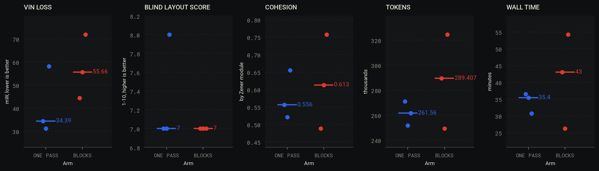
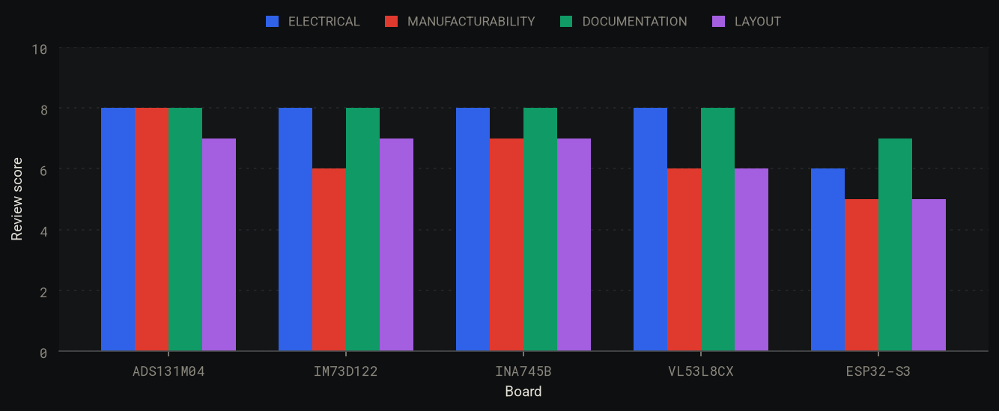

# Spike 6: block-by-block placement, and three copper rules

Issue: [#6](https://github.com/alexchunlin/alex-pcb-skills/issues/6). Branch `spike/6-block-placement` from `main` at df0f2d8. This file is committed before the first scored
designer run, so the design below is fixed ahead of the results. Later changes go under "Design changes after the Method commit".

## Why

Alex: a person lays out a circuit block by block from the schematic (power stage, then sensors, then the microcontroller)
and connects the blocks last; placing everything at once gives messier boards. He also asked for three rules after reading
board renders: no vias in pads, ground fill islands tied to ground with vias instead of ripped up, and copper further from
the board edge.

## Evidence before the method

Cohesion: mean share of a part's 3 nearest parts in its own schematic block, normalised so 0 = shuffled labels, 1 = all
(`pcb block report`; scratch form `/tmp/spike6/cohesion.py` on 216 unique corpus boards with at least 2 blocks, 20 parts).

| Boards | Cohesion |
|---|---|
| Rung-2 Sonnet a1, Opus a1, Opus a2 | 0.60, 0.67, 0.58 (15th to 26th percentile of the row below) |
| Corpus, 25-60 parts and 3-7 blocks (n = 34) | median 0.77, IQR 0.63-0.85 |
| Plink, Pace-core (human, built) | 0.82, 0.62 |

Cohesion alone is not quality: Pace-core is a real board at the LLM level. On the LLM boards the IC blocks are tight (0.74-0.96)
and the small ones loose. Opus a2's script has block headings but wrote the placement in one table, with power copper and zones,
in one step. Spike 1 arm (ii) gave KRT's placer the same modules as groups and routed 2 of 7 and 0 of 9 clean, so grouping alone
does not carry the claim: the test here is the designer's working order.

### Rule measurements (four archived placements, tracks stripped, `pcb route auto` before and after)

| Board | SMD pads with a router via | Vias | Length mm | Nearest via mm | Clean |
|---|---|---|---|---|---|
| opus2 before / after | 12 / 0 | 43 / 38 | 632 / 680 | 0.45 / 1.05 | yes / yes |
| opus before / after | 16 / 1 | 53 / 32 | 494 / 493 | 1.55 / 3.15 | yes / yes |
| sonnet before / after | 10 / 0 | 44 / 38 | 437 / 439 | 2.15 / 2.35 | yes / yes |
| r1 before / after | 10 / 0 | 19 / 20 | 184 / 208 | 0.65 / 2.85 | yes / no (INT2 open) |

r1's INT2 stays open with either flag alone, so the placement is marginal there and the rule costs one clean verdict in four.
The attempt-2 board on the two-plane stackup, routed outer-only (2 airwires left on this placement), had 10 ground fill pieces over
2 mm² with no ground copper (largest 97.5 mm² on B.Cu); `pcb route ground-islands` placed 11 vias in 7.6 s, `gnd_islands` went to 0
fails and 3 warns, DRC 0 errors.

## Method: the A/B (fixed before the first scored run)

**Question.** With the rules held constant, does placing block by block with gates beat placing the board in one pass?

**Input, both arms.** The rung-2 attempt-2 design at the netlist stage: `motor1.zen`, `modules/`, `parts/`, `calcs/`, datasheets,
`PINMAP.md`, the brief, and `checks.json` with the `feeds`, `decoupling`, `signals`, `currents` and `thermal_vias` rows, plus
`refplane`, `return_via`, `feed_room`, `via_in_pad`, `edge_margin` and `gnd_islands`. Nothing that reveals a placement: no
layout script, layout directory, design log, bring-up or review. Stackup: two solid GND planes (In1, In2), Alex's policy.

**Arms.** A: the skill as it stands, one designer places and routes. B: the same plus `reference/block-placement.md`, gates
enforced by `pcb block`. Three runs per arm (`s6-a-1..3`, `s6-b-1..3` in `~/code-stuff/alex-pcb-runs/`), Opus 5.5 at medium effort,
same prompt apart from the one PATH.md line. Stop at a routed, checked board; schematic changes are out of scope, no fab or
bring-up documents. Time cap 90 min.

**Judges, applied by the session on the handed-in board, not by the designer.**

| Rank | Judge | How |
|---|---|---|
| 1 | Finished: airwires 0 and DRC 0 errors, packed | `pcb route measure --drc`, `pcb drc --pack jlcpcb` |
| 2 | `pcb check` fails over all rows | same `checks.json`, tools at the method commit |
| 3 | VIN loss mW, `refplane` bucket-3 mm, `return_via` bad | `pcb irdrop`, `pcb check` |
| 4 | Reviewer layout score | `skills/pcb-design-review`, Opus (Fable out of credits), blind to the arm, on a copy with `blocks*` files removed |
| 5 | Cohesion, tokens, wall time | `pcb block report`, agent usage |

**Decision.** B becomes the skill's default if at n = 3 it finishes at least as often as A, its median of judge 2 is no worse,
and it improves the median of at least one of judges 3 and 4, at no more than 1.3× A's median tokens. Otherwise it stays
opt-in and the numbers go on the issue. Three runs detect a large effect only.

**Null.** Block order changes cohesion and nothing the judges care about, or costs more tokens than it returns.

## Method: breakouts (a readiness test, not an A/B)

Five boards on the skill, Opus 5.5 at medium, block order on, the three copper rules on: four parts not yet sold as an Adafruit or
SparkFun breakout, and one ESP32-S3 devkit on the bare chip (no module). Brief: `bench/design/rung3-breakouts/`. Reviewer as above.
Question: how close to orderable is a board with one designer pass? Reported per board: review scores, blockers, wall time, tokens,
and what a person would still have to do.

## Why not the existing code

- **Via in pad:** configuration, not code. KRT's `--same-net-pad-clearance` (default allows via in pad), now passed by every route
  call; `return_vias` also refuses SMD pads. New: the `via_in_pad` row, because no row looked. KRT's `fab_notes` only prints a note.
- **Edge:** configuration. KRT's `--board-edge-clearance` at 1.0. New: the `edge_margin` row, because DRC only checks the fab floor.
- **Islands:** KRT `route_planes --stitch-vias` lays a lattice and rejects off-cluster sites by design (it does not anchor islands),
  and KiCad's island removal only deletes. New: `ground_islands`, reusing `return_vias`' spot test.
- **Block gates:** KRT `check_groups` and the `groups.json` format are reused as they stand (`pcb block plan` calls it and prints its
  link matrix). KRT's placer places the groups by search; spike 1 measured that at 2 of 7 and 0 of 9 clean, and it has no notion of
  an order or a gate. New: `pcbblock.py`. KiCad 10's rule areas could assert the regions but not the order.

## Design changes after the Method commit

- **Tool bug fixed mid-run, both arms alike.** The island step of `pcb route auto` crashed with `UnboundLocalError` (`_sh`) on any board
  that reached 0 airwires without entering the stitch branch. Found by `verify_all` after the designers had started, fixed in the shared
  scripts, and all seven running designers were told. No judge or row changed.
- **Reviewer replaced.** Board 6's blind reviewer stalled with no output for over 1.5 h and was stopped; a fresh Opus reviewer did the board from the same blind copy.
- **Judge 1 command.** `pcb q ratsnest` and `pcb drc --pack jlcpcb` gave the finished verdict; `pcb route measure --drc` as written in the Method was not needed.
- **After the results (rule tuning, not a change to the A/B).** Via-to-pad gap 0.15 to 0.10 mm, from a grid on three Qwiic placements below. `edge_margin` now measures courtyards and pours on every layer, inner planes included, and `b.zone` insets 1 mm by default (Alex). `pcb cpl`, `pin1_mark` added.
- **Second mid-run fix.** `_via_spot` gained 0.02 mm of margin after a `ground-islands` via landed 0.199 mm from R6.2 on s6-a-1 (HitTest rounds).
  All three A designers and b-2 had finished; b-1, b-3 and the breakouts got it. No judge or row changed.

## Results

### A/B: block order did not beat one pass

| Judge | One pass (a-1, a-2, a-3) | Block order (b-1, b-2, b-3) | Better median |
|---|---|---|---|
| 1 Finished: 0 airwires, 0 packed DRC errors | 3 of 3 | 3 of 3 | tie |
| 2 `pcb check` fails | 0, 0, 0 | 0, 0, 1 | tie at 0 |
| 3 VIN loss, mW | 34.4, 31.1, 58.2 (34.4) | 44.4, 55.7, 71.9 (55.7) | one pass |
| 3 `refplane` bucket 3 mm, `return_via` bad | 0, 0 | 0, 0 | tie |
| 4 Blind layout score | 7, 7, 8 (7) | 7, 7, 7 (7) | tie |
| Blind electrical, manufacturability | 8, 8, 8; 8, 8, 9 | 8, 8, 8; 8, 8, 8 | tie |
| Majors | 3, 3, 2 (3) | 1, 3, 2 (2) | block order, by one |
| 5 Cohesion | 0.56, 0.52, 0.66 (0.56) | 0.49, 0.61, 0.76 (0.61) | block order |
| 5 Tokens, thousands | 271, 252, 262 (262) | 289, 249, 324 (289) | 1.10x |
| 5 Minutes | 36.5, 35.4, 30.7 (35.4) | 43.0, 26.2, 54.2 (43.0) | one pass |

**Verdict under the pre-registered rule: not met.** Block order finished as often and its median of judge 2 is no worse, and it is inside the token limit, but it improved neither judge 3 nor judge 4. `pcb block` stays opt-in. The null holds at n = 3: cohesion moved a little and nothing the judges care about moved with it.

**What this does and does not say.** Three runs detect a large effect only, and block order showed none on this board. It does not refute Alex's practice: the arm tested the mechanical gate, not a person's judgement, and it was the weak version.

- Gates ran without their `decoupling` and `feed_room` rows until a netlist existed, because `pcb block gate` skipped them silently. All three B designers hit this; b-3 lost about 8 min to rework when the rows first ran.
- Parts moved after a gate on b-2 (7 parts) and b-3 (5), and the tool would not re-gate earlier blocks.
- The boards' weak spots across both arms were not block problems: ground returns with no via (C2, C3, C5-C7, C17, D4), no heat copper on U3, and 3V3 and control nets arcing round the board. Every reviewer praised the buck core on every board.
- One-pass designers already think in blocks. Earlier archived boards had 0.58-0.67, and the one-pass runs here landed at 0.52-0.66.

### The three rules on fresh boards

| Rule | Result |
|---|---|
| No via in pad | `via_in_pad` 0 fails on all 6 A/B boards at hand-in. Router vias in SMD pads 10-16 to 0-1 on archived boards |
| Ground islands | Every A/B board hands in with `gnd_islands` 0 fails. b-3 keeps 6 warns under 2 mm² where no via fits; VL53L8CX keeps 4 |
| Edge margin | 0 fails at hand-in, but the row measures pads: a reviewer found C17's courtyard 0.405 mm off the edge on s6-b-2 |

Cost: the Qwiic board gets either an open net (INT2) or 2 `starved_thermal` errors, depending on the input. That is the one `verify_all` failure left on this branch (section 27, `route auto`, pinned to CLEAN), left in place on purpose until the rule is settled.

**The rules are not why the router fails on small boards.** Same placements, tracks stripped, rules off and on:

| Board | Airwires of 89 / 127, rules off | Rules on |
|---|---|---|
| VL53L8CX | 12 | 18 |
| ESP32-S3 | 39 | 39 |

These placements were made for hand routing, so this bounds the rules' cost and does not measure the router on a router-first placement.

### Breakouts: five designs, five "order after small fixes", none ready as generated

| Board | Elec / Manuf / Doc / Layout | Blockers, majors, minors | Minutes | k tokens | Router in regen |
|---|---|---|---|---|---|
| ADS131M04 ADC | 8 / 8 / 8 / 7 | 0, 4, 13 | 44 | 380 | no |
| IM73D122 mic | 8 / 6 / 8 / 7 | 1, 2, 11 | 46 | 330 | yes |
| INA745B power monitor | 8 / 7 / 8 / 7 | 0, 4, 12 | 59 | 466 | no |
| VL53L8CX ToF | 8 / 6 / 8 / 6 | 1, 3, 14 | 111 | 835 | no |
| ESP32-S3 bare chip | 6 / 5 / 7 / 5 | 1, 8, 20 | 139 | 730 | finishes after 35 GPIO nets by hand |

Run directories: `~/code-stuff/alex-pcb-runs/r3-*-a1`, each with `review/`. The reviewers were not blind and every design is unbuilt.

**Are we at the point where breakouts can be made? For sensor breakouts, nearly, with a reviewer and a person at the JLC preview. For a bare-chip radio board, no.** The four sensor boards had a correct circuit and footprint by independent check, and their fixes need no re-layout. Tool checks read clean on all of them while a board-killing fault sat in the fab package, so the checks are not the gate yet.

- **CPL rotation is the blocker.** Three of three boards examined have parts rotated wrongly for JLC (IM73D122 U1, U2; VL53L8CX U3, U4, U5; ESP32-S3 J3 and probably U1, U3). `pcb fab` writes KiCad rotations, and no row checks them. The evidence is footprint fitting and community tables; nobody has uploaded to JLC's preview. ADS131M04 and INA745B were not examined this way.
- **Datasheet reading errors:** ESP32-S3 GPIO47 and GPIO48 swapped everywhere; ADS131M04 filter ignores sinc3; INA745B LDO reverse voltage 0.6 V against 0.3 V.
- **A rule designers write around:** limits set from the layout (ESP32-S3 C11, C12; VL53L8CX C2) and courtyards trimmed to fit. On VL53L8CX the trim hid C6 touching U4.
- **ESP32-S3 RF:** match 3.83 mm from the pin over a 65 ohm section, XIN 0.99 mm from the RF row. Impedances solve correctly on JLC04161H-7628, which the package does not name. No simulation, no measurement.

### After the report: rotation, the Qwiic cost, planes

**CPL rotation.** The fault is the number in the CPL, not a footprint or a 3D model: JLC turns a part by the EasyEDA footprint of its LCSC number. And Alex's correction: JLC's engineers align pin 1 to the silk wherever they can, so a wrong rotation is a preview and rework cost, not the dead board the reviews called it. `pcb cpl` wraps the vendored `jlcfootprint` solver from kicad-jlcpcb-tools (MIT) and `pcb fab` applies its trusted corrections: 11 ICs across the five boards, corrected CPLs in `examples/rung3-*/fab/`. LEDs, diodes and the INA745B terminals stay with a person. On 12 of 12 ICs the pin-1 token in EasyEDA's package name agrees with the pad fit (+270 for -BL, +180 for -BR, 0 for -TL). No built board gave ground truth: Pace's production file looks footprint-name-table driven, and Plink's is a raw export. **One upload to JLC's preview is still the real test.** `pin1_mark` is weak: a nearby label can satisfy it.

**Qwiic.** Via-to-pad gap against three placements, edge setting 0.6 and 1.0 gave the same result in every cell:

| Placement | 0.15 mm | 0.10 mm | 0.05 mm |
|---|---|---|---|
| Rung-1 a1 | 2 `starved_thermal` | clean | clean |
| Rung-1 a2 Fable | clean | clean | clean |
| Rung-1 a2 Sonnet | INT2 open | INT2 open | INT2 open |

At 0.10 mm the motor boards stay clean with 0, 1, 0 vias in SMD pads. INT2 leaves U1 pin 9 on a 0.5 mm LGA for J3 pin 2; one net a designer can hand-route.

**Planes.** Four of the five rung-3 boards as reviewed have pours 0.45-0.55 mm off the outline and fail the new `edge_margin`. They were not changed.

### Tool list, ranked

1. Done: `pcb cpl`. Next: confirm the sign on JLC's preview.
2. `pcb route`: reads the project `.kicad_dru` (INA745B: CLEAN, then 46 DRC errors), keeps hand copper and pour vias (reported by a-2, a-3, b-3, ESP32-S3), stops adding stubs on poured nets (all six A/B runs needed a post-route script).
3. `pcb block gate`: fail when the netlist is missing, re-gate from any block, honour `skip_refs`; append-only log (VL53L8CX cleared and re-gated).
4. `feeds` counts dangling vias. New row for same-net pads overlapping across footprints (R3.1 on U1.8). Row for a GND pad with no nearby via.
5. `pcb irdrop`: per-run default directory (shared `/tmp/pcb-irdrop` crossed boards twice, no scored number affected) and relative paths. `pcb fab`: split PTH and NPTH drills. `pcb regen-check --out` inside the project recurses.
6. Open, not reproduced: `ground-islands` via in a pad, reported on s6-a-1 and ESP32-S3; `--return-vias` GND via shorted to 3V3 on s6-b-3.

### Not worth our time

More A/B runs of this gate on this board before item 3 above. A cohesion row as a failing check: Pace-core, a built board, scores like the LLM boards.
